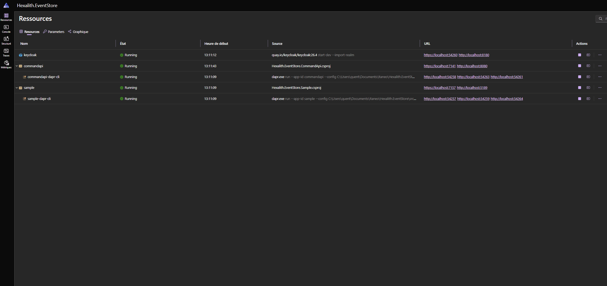
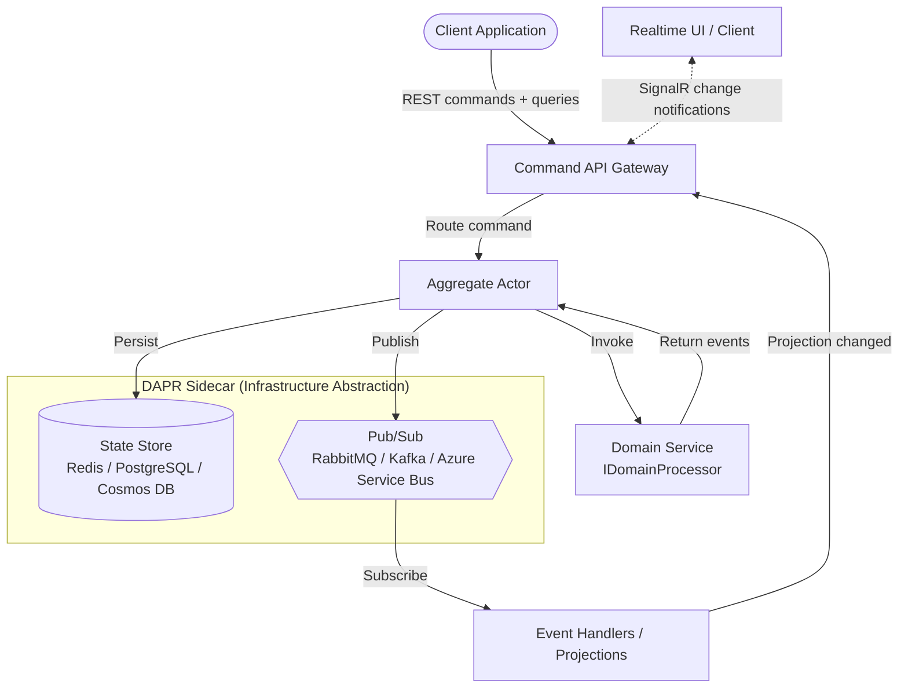

# Hexalith.EventStore — DAPR-native event sourcing server for .NET

[](https://github.com/Hexalith/Hexalith.EventStore/stargazers)
[](https://www.nuget.org/packages/Hexalith.EventStore.Contracts)
[](https://github.com/Hexalith/Hexalith.EventStore/actions/workflows/ci.yml)
[](https://github.com/Hexalith/Hexalith.EventStore/actions/workflows/docs-validation.yml)
[](LICENSE)

If you've spent weeks wiring up an event store, a message broker, multi-tenant isolation, and a read-model refresh story — only to realize you'll do it again for your next project — we built this for you. Hexalith.EventStore is a distributed, CQRS and DDD-ready event sourcing framework that handles command routing, event persistence, snapshots, query execution, and pub/sub delivery so you can focus on domain logic. Built on DAPR for infrastructure portability.

## The Programming Model

Your domain logic lives in an aggregate class with typed `Handle` methods — conceptually a pure function: $(Command, CurrentState?) \rightarrow List<DomainEvent>$. Each `Handle` method receives a specific command and the current state, then returns a `DomainResult` carrying success events or rejections.

```csharp
public sealed class CounterAggregate : EventStoreAggregate<CounterState>
{
    public static DomainResult Handle(IncrementCounter command, CounterState? state)
        => DomainResult.Success(new IEventPayload[] { new CounterIncremented() });

    public static DomainResult Handle(DecrementCounter command, CounterState? state)
    {
        if ((state?.Count ?? 0) == 0)
            return DomainResult.Rejection(new IRejectionEvent[] { new CounterCannotGoNegative() });
        return DomainResult.Success(new IEventPayload[] { new CounterDecremented() });
    }

    public static DomainResult Handle(ResetCounter command, CounterState? state)
    {
        if ((state?.Count ?? 0) == 0)
            return DomainResult.NoOp();
        return DomainResult.Success(new IEventPayload[] { new CounterReset() });
    }
}

public sealed class CounterState
{
    public int Count { get; private set; }
    public void Apply(CounterIncremented e) => Count++;
    public void Apply(CounterDecremented e) => Count--;
    public void Apply(CounterReset e) => Count = 0;
}
```

> Under the hood, `EventStoreAggregate<TState>` implements `IDomainProcessor` — you can still use that interface directly for advanced scenarios (see the legacy [`CounterProcessor`](samples/Hexalith.EventStore.Sample/Counter/CounterProcessor.cs) example).

## Why Hexalith?

| Feature                    | Hexalith                         | Marten               | EventStoreDB                | Custom       |
| -------------------------- | -------------------------------- | -------------------- | --------------------------- | ------------ |
| Infrastructure portability | Any store/broker, zero-code swap | PostgreSQL only      | Dedicated server            | You build it |
| Multi-tenant isolation     | Built-in: data, topics, access   | Manual               | Manual                      | You build it |
| CQRS/ES framework          | Complete, infra-agnostic         | Complete, PG-coupled | Storage only, BYO framework | You build it |
| Deployment                 | DAPR sidecar: Docker, K8s, ACA   | App library          | Server + clients            | You build it |
| Database lock-in           | None (Redis, PG, Cosmos, etc.)   | PostgreSQL           | EventStoreDB                | Chosen DB    |

> **Note:** Hexalith is not the right tool for every scenario. If you need raw event stream performance or already run PostgreSQL everywhere, see the [decision aid](docs/concepts/choose-the-right-tool.md).

## Get Started

Register the event store in two lines — `AddEventStore()` scans your assembly for aggregate types, no manual registration needed:

```csharp
builder.Services.AddEventStore();  // Auto-discovers CounterAggregate
// ...
app.UseEventStore();               // Activates domains with convention-derived names
```

Beyond commands, the platform includes a query pipeline with ETag-based cache validation, projection invalidation hooks, preflight authorization endpoints, and optional SignalR notifications for real-time read-model refresh.

**Get started in under 10 minutes** — follow the [Quickstart Guide](docs/getting-started/quickstart.md).

Prerequisites: [.NET SDK](https://dotnet.microsoft.com/download), [Docker Desktop](https://www.docker.com/products/docker-desktop/), [DAPR CLI](https://docs.dapr.io/getting-started/install-dapr-cli/)

## Run and Debug in the Platform Workspace

EventStore runs and debugs as a module from the [Hexalith.Platform](https://github.com/Hexalith/Hexalith.Platform) workspace, where this repository is the `references/Hexalith.EventStore` submodule. From the Platform root, with the pinned module tool, Aspire CLI `13.6.1` exactly, Docker, and `HEXALITH_DAPR_HOME` pointing at an isolated Dapr home (CLI `1.18.0` at `tools/dapr`, runtime `1.18.2` in `.dapr/bin`):

```bash
dotnet tool restore
dotnet restore apphost.cs
dotnet tool run hexalith-module -- debug --manifest references/Hexalith.EventStore/module/hexalith.module-manifest.v2.json
dotnet tool run hexalith-module -- down --manifest references/Hexalith.EventStore/module/hexalith.module-manifest.v2.json
```

Initialize the Platform workspace's direct `references/Hexalith.Builds`, `references/Hexalith.EventStore`, `references/Hexalith.Tenants` and `references/Hexalith.Memories` checkouts without `--recursive`, with each `HEAD` matching its staged Platform gitlink. The tool reads all three declaration owners even for EventStore alone. `dotnet restore apphost.cs` installs the local Aspire orchestration and dashboard packages before the first run; tool restore alone does not. If NuGet uses a custom `globalPackagesFolder`, set `NUGET_PACKAGES` to that absolute folder for both restore and `debug`; otherwise the tool checks `~/.nuget/packages` and reports `HXR016` if the packages are missing.

`debug` builds `references/Hexalith.EventStore` in Debug, starts only the `eventstore` gateway with its Dapr sidecar, the Dapr control plane and Redis, waits for `/ready`, and reports the `dotnet run` launcher process id. Attach your debugger to the launcher's child process (`ps --ppid <launcher-pid> -o pid,args`). Stay attached until you finish, then stop the run with `down`. See [CONTRIBUTING.md](CONTRIBUTING.md#run-and-debug-in-the-platform-workspace) and the Platform README for the full prerequisites.

`debug` does not print the run id: it is the file name of the run state `<runId>.json` under `${XDG_DATA_HOME:-$HOME/.local/share}/hexalith-builds/g4-runs/` on Linux. Inspect the state files and select the one whose `projectProcessIds` contains the launcher id reported by this `debug` invocation. Confirm its `manifestHash` matches `sha256sum references/Hexalith.EventStore/module/hexalith.module-manifest.v2.json` (ignoring hexadecimal letter case), then use its `runId`. File modification time alone cannot identify your run. When an earlier run used the same manifest, `down --manifest` refuses with `HXR024`; add `--run-id <runId>`. An explicit `--run-id` is not cross-checked against the manifest, so verify both fields before stopping it.

This repository's own `src/Hexalith.EventStore.AppHost` serves only this repository's own tests. A run of it is never evidence that EventStore runs in the Platform composition.

## Architecture



<details>
<summary>Architecture diagram text description</summary>

The system follows a command-event architecture with a built-in read-model refresh path: client applications send commands and queries via REST to the Command API Gateway, which routes commands to Aggregate Actors and queries to projection handlers. Each actor invokes the domain service (your `IDomainProcessor` implementation) and persists resulting events to a state store. Events are published to a pub/sub system for downstream consumers, and projection changes can be surfaced back to clients through HTTP cache validators and optional SignalR notifications. DAPR provides the infrastructure abstraction layer, allowing you to swap state stores (Redis, PostgreSQL, Cosmos DB) and message brokers (RabbitMQ, Kafka, Azure Service Bus) without changing application code.

</details>

## Documentation

Full documentation index: [Documentation](docs/index.md)

### Getting Started

- [Quickstart Guide](docs/getting-started/quickstart.md) — up and running in under 10 minutes
- [Prerequisites](docs/getting-started/prerequisites.md) — required tools and environment setup

### Concepts

- [Architecture Overview](docs/concepts/architecture-overview.md) — system topology and design decisions
- [Choose the Right Tool](docs/concepts/choose-the-right-tool.md) — when Hexalith is (and isn't) the right fit
- [Event Versioning & Schema Evolution](docs/concepts/event-versioning.md) — safely evolving event schemas over time

### Guides

- [Upgrade Path](docs/guides/upgrade-path.md) — migrating between versions
- [DAPR FAQ Deep Dive](docs/guides/dapr-faq.md) — honest answers about DAPR dependency, risks, and operational costs
- [Deployment Guides](docs/guides/) — Docker Compose, Kubernetes, Azure Container Apps
- [Production Deployment Configuration](deploy/README.md) — DAPR component configs, backend swap, secret management

### Reference

- [Command API Reference](docs/reference/command-api.md) — command submission, status, replay, and preflight validation
- [Query & Projection API Reference](docs/reference/query-api.md) — query execution, ETag caching, projection notifications, and SignalR
- [NuGet Packages Guide](docs/reference/nuget-packages.md) — package roles, dependencies, and installation guidance
- [Native AOT and IL Trimming Posture](docs/reference/aot-and-trimming-posture.md) — current compatibility posture and reflection convention inventory
- [Generated API Reference](docs/reference/api/) — auto-generated public type documentation

### Community

- [Product Roadmap](docs/community/roadmap.md) — planned features and project direction
- [Awesome Event Sourcing](docs/community/awesome-event-sourcing.md) — curated ecosystem resources
- [GitHub Discussions](https://github.com/Hexalith/Hexalith.EventStore/discussions) — questions, ideas, and community support
- [Issue Tracker](https://github.com/Hexalith/Hexalith.EventStore/issues) — bug reports and feature requests

## Contributing

Contributions are welcome! Please read the [Contributing Guide](CONTRIBUTING.md) and [Code of Conduct](CODE_OF_CONDUCT.md) before submitting a pull request.

## License

This project is licensed under the [MIT License](LICENSE).

See the [Changelog](CHANGELOG.md) for release history and notable changes.


### Bounded aggregate generation staging

`DomainProjectionRebuildPlan.StagedOperations` carries disjoint, create-only,
nonexpiring generation values prepared without side effects. After all handlers
prepare successfully, the dispatcher persists these through
`ReadModelGenerationStaging` in resumable groups below the normal batch limits,
then coordinates only the canonical authority operations. Domain pointers must
select the generation only in that final commit and retain optimistic concurrency
and erasure protections. A staged generation alone grants no read authority.

The dispatcher constructs and validates the complete canonical batch, including
guarded ownership, before staging any generation. Every generation group is
validated before the first storage write. Malformed combined plans therefore
leave no staged values. Staging storage failures preserve their structured SDK
retryable or indeterminate outcomes in both ordinary and streamed rebuild
routes; preparation exceptions do not escape the dispatch outcome protocol.

Generation staging retains its default 512-KiB canonical-manifest and 32-operation
group limits. An additive explicit byte-budget overload and
`DomainProjectionRebuildPlan.GenerationStagingMaxCanonicalManifestBytes` support
previously accepted larger individual immutable values, capped at the unchanged
1-MiB hard recovery ceiling. Conservative group partitions stay unchanged when
all values already fit, preserving earlier staging identities on retry. All groups are measured with base64 encoding and scope overhead
and preflighted against effective store limits before the first write.

`IReadModelRecoveryScopeStore.SettleRecoveryScopeAsync` finishes registered committed
attempts and releases proven terminal registrations for one exact aggregate.
It preserves Prepared work, including guarded rebuilds, and never uses erasure
retirement for ordinary delivery recovery. Discoverable enrollment performs this
settlement before adding another active registration. Both store profiles retain
matching participant counts, terminal fences and content-free manifest barriers;
all discoverable batches obey the hard recovery limits even when guarded ownership
permits `RetainManifestForRecovery=false`.
