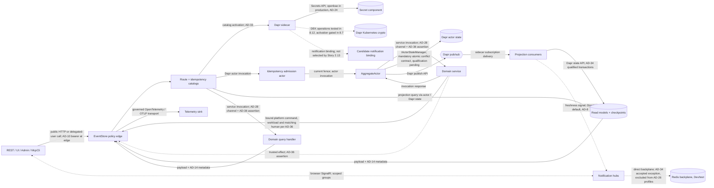
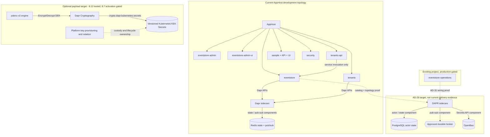

# Architecture Spine - eventstore Phase 4 Implementation Readiness Recovery

## Design Paradigm

Hexalith.EventStore is a DAPR-backed hexagonal event-sourcing platform. The EventStore host is the command and query policy edge; DAPR actors serialize aggregate writes; domain services remain pure domain adapters; generated REST hosts, interactive clients, Admin surfaces, and the Hexalith.McpCli CLI/MCP heads (AD-35) use platform seams rather than owning domain persistence. Dapr is the infrastructure boundary (AD-1, AD-34); protected sidecar service invocations use the receiver's channel token and the route's declared admission identity. The platform-scoped form of the signed bound-command route also requires independent human authorization on the same hop (AD-36).

OQ8 admission follows the retained design in AD-25. Hosted checks verified its availability on the source revisions recorded there. Runtime conformance and Phase 4 readiness still require their own evidence.



> **Implementation status:** Adopted decisions are not delivery evidence. Production workload promotion, traffic, consumer migration, and production-readiness claims remain prohibited until the final Implementation Status and Production Gates table is satisfied.

## Invariants And Rules

`[ADOPTED]` records an accepted architecture decision, not an implemented or proven capability. Each rule and the final gate table continue to govern brownfield gaps and production-evidence requirements. `[ASSUMPTION]` marks a decision that awaits owner ratification; only the AD-26 production target carries it, and the tag on the AD-26 heading marks that target alone, so the rest of AD-26 binds as adopted. An `[ASSUMPTION]` is open only as a tag on an AD heading or clause, never as a quoted mention inside a rule.

| Theme | Decisions |
| --- | --- |
| Platform core and module boundaries | AD-1 through AD-4, AD-34, AD-35 |
| Mutation, delivery, and query correctness | AD-5 through AD-8, AD-14 through AD-15, AD-19 through AD-20, AD-25, AD-30 |
| Runtime, security, and identity | AD-9 through AD-10, AD-16 through AD-18, AD-24, AD-26 through AD-29, AD-31 through AD-33, AD-36 |
| Release, evidence, evolution, and UI | AD-11 through AD-13, AD-21 through AD-23 |

### AD-1 - DAPR-Backed Hexagonal Event Sourcing [ADOPTED]

- **Binds:** FR1-FR37, NFR1-NFR19
- **Prevents:** incompatible CRUD and event-sourcing implementations.
- **Rule:** The platform uses CQRS, DDD, and event sourcing with Dapr as the required infrastructure boundary for every EventStore runtime package and host, including samples, linked source, and generated-host inputs, under PRD §8.4. An operation that a suitable Dapr API or component supports is reached only through the highest applicable Dapr abstraction; for it, application code adds no database driver, broker client, cloud SDK, direct provider HTTP call, provider connection string or credential, or provider schema. An operation Dapr cannot supply requires an AD-34 accepted exception decided before the dependency is introduced. Unknown suitability stays unresolved; convenience, familiarity, a missing SDK helper, or unmeasured performance is not a capability gap; a generic binding carrying application-owned SQL or provider protocols is not portability evidence and cannot bypass actor ownership; and a Dapr failure never falls back to direct infrastructure. Aggregate/event/snapshot and existing actor drain-registration mutations remain solely `IActorStateManager`-owned, actor-owned state is addressed only through its actor boundary, application code never reads or writes Dapr private actor-state keys, tables, or caches, and domain modules receive no direct persistence authority. Aspire owns the local orchestration seed and production is governed by AD-26. The 2026-10-04 PostgreSQL metadata-adapter permission stays withdrawn, as recorded under AD-13; Story 6.6 follows AD-13's 2026-10-09 pragmatic scope.

### AD-2 - Domain Modules Stay Domain-Centric [ADOPTED]

- **Binds:** FR1-FR10, FR33
- **Prevents:** domains choosing incompatible hosting, persistence, query, cursor, health, or telemetry infrastructure.
- **Rule:** Domain modules contain behavior and contracts only. Reusable infrastructure lives in EventStore libraries. A conforming host calls `AddEventStoreDomainService()` and `UseEventStoreDomainService()`.

### AD-3 - Gateway Is The Command And Query Policy Boundary [ADOPTED]

- **Binds:** FR11-FR16, FR23-FR32, NFR1-NFR4, NFR14
- **Prevents:** external adapters bypassing authorization, tenant validation, idempotency, status, ETag, error, and observability policy.
- **Rule:** External command and query entry points delegate to EventStore platform APIs. Reads of platform-owned operational state use named, support-safe Dapr adapters authorized for the requested operation and its AD-27 scope. This permits neither provider drivers nor reads of Dapr private actor-state keys/tables. Actor-owned state is addressed through its actor boundary. External callers never receive generic-key access or direct mutation authority.

### AD-4 - Generated REST Lives In Dedicated External API Hosts [ADOPTED]

- **Binds:** FR11-FR15, NFR12-NFR14
- **Prevents:** interactive UI hosts acquiring a second controller policy surface.
- **Rule:** `Hexalith.EventStore.RestApi.Generators` emits controllers only into external API hosts. Those controllers use `IEventStoreGatewayClient`; interactive UI hosts use EventStore client libraries and host no per-message MVC command/query controllers.

### AD-5 - Admission Precedes AggregateActor-Owned Durable Event Mutation [ADOPTED]

- **Binds:** FR23, FR27, FR29-FR31, NFR7
- **Prevents:** split-brain persistence and mutation without a durable execution authority.
- **Rule:** Every production aggregate mutation or side effect requires a non-empty opaque idempotency key, a successful AD-25 admission, and the current nonzero fence. `null`, empty, unknown, or stale fences never authorize work. `AggregateActor` is the sole event-append coordinator and accepts only an internal fenced execution context before domain invocation or any append, recovery, snapshot, projection, audit, provider, repository, or scheduling effect. Existing unfenced entry points are compatibility seams only: they fail closed or remain unmapped outside Development. This requirement does not apply to reads or cataloged non-aggregate maintenance.

**Append race (NFR7 class (c)).** Story 4.16 may satisfy NFR7 class (c) through a mechanically enforced no-second-writer envelope, or through mandatory atomic conflicting-write protection in the Dapr-owned actor persistence path. The latter requires one qualified actor transaction to condition on a durable actor-state revision, create each event identity only if absent, and atomically commit or reject all staged actor state. Same-identity raw calls cannot opt out, replace committed events, or use deletion or TTL as a bypass; existing authorized erasure remains available through its governed authority and invalidates stale writers. AggregateActor remains the sole event-append coordinator and mutations remain IActorStateManager-owned. A current OQ8 admission fence, optional ETag, placement lock or client existence check does not supply this contract. The exact protection mode, SDK/runtime/component versions, writer inventory, erasure behavior and failover assumptions bind into AD-26; production-path positive controls, adversarial writes and barrier-removal tests must pass. Unsupported or unproven protection leaves G-APPEND unmet. This approves no new activation-epoch system, application provider access or cross-component transaction. Component scopes and ACLs act per component, not per key, so they cannot alone exclude a second writer: each actor-hosting app ID that the AD-34 inventory enumerates has its own `actorStateStore: true` component scoped to it alone in every profile. In a PostgreSQL profile the component declares its physical target (`host`, `port`, `database`, `tableName`, and its own `metadataTableName`) as plain metadata and takes only credentials through `secretKeyRef`, and its app ID, namespace, and physical target are bound into the AD-26 digest. Dapr `keyPrefix` never applies to actor state and actor keys carry no namespace, so no other component in any profile names that physical target, and database credentials for it are granted to one app ID in one namespace of one environment. The G-APPEND proof shows both beside a positive control: the rendered components and the AD-34 inventory name no second component on the target, and a sidecar with the same app ID in another namespace or environment is refused by the database. EventStore's component keeps the name `statestore`; every other component name follows one convention, unique per namespace and identical in the AppHost and production, and no SDK or host default names another app's component. An app that hosts actors reaches no other app's actor-state component, and its other state, such as `IReadModelStore` read models, lives in separately scoped components. State that any other app reads lives in separately scoped components, the AD-26 profile and the AD-34 inventory enumerate them with their data migration, and AD-9 parity is reached by moving the AppHost to that posture, never by widening production. Any remaining writer is proven absent at code level through the AD-34 inventory, and the envelope is re-proven on every DAPR runtime minor-version change because placement and scheduler authority are runtime-specific.

### AD-6 - Persisted Event Identity Is Stable [ADOPTED]

- **Binds:** FR23-FR24, FR27, NFR6-NFR7
- **Prevents:** incompatible event identity and ordering semantics.
- **Rule:** Aggregate sequence is gapless per aggregate. The DAPR-backed allocator assigns unique, nonzero, monotonically increasing `GlobalPosition` values and reserves a contiguous range for each command batch. An aggregate commit can fail after reservation. Its unused positions stay unused. Readers tolerate gaps and concurrent commits that become visible out of allocation order. CloudEvent `id` is the persisted event `MessageId`. Duplicate replies preserve the original result. Sharding requires an approved revision to the frozen global-ordering spec.

### AD-7 - Read Models And Cursors Use Platform Seams [ADOPTED]

- **Binds:** FR5-FR6, FR9, FR33, FR36, NFR8, NFR16
- **Prevents:** per-domain concurrency, cursor, and erasure semantics.
- **Rule:** Read models use platform lifecycle and write contracts. MVP projection read-model/checkpoint erasure is typed, tenant/domain/aggregate/projection-scoped, idempotent, and read-back-proven; it reports only projection removal and makes no broader GDPR, event, broker, backup, or cryptographic-erasure claim. Multi-key changes use one AD-34-qualified transaction within a single Dapr state component, never spanning actor-owned state, another component, pub/sub, or external effects, or an approved resumable equivalent with explicit atomicity, recovery, idempotency, concurrency, ordering, and completion. Cursors use `IQueryCursorCodec` plus `QueryCursorScope`; they are opaque, bounded, protected, scope-validated, and fail safe.

### AD-8 - Projection Delivery Is A Freshness Signal [ADOPTED]

- **Binds:** FR7, FR16, FR34, FR36, NFR5-NFR6, NFR12, NFR15-NFR16
- **Prevents:** transport acknowledgement being presented as projection-confirmed success.
- **Rule:** Domain-event pub/sub delivery is at-least-once and unordered. Within each subscription, external CloudEvents subscribers deduplicate on the received `(source, id)` pair. The publisher uses the persisted event `MessageId` as `id`. The EventStore subscriber processor deduplicates on that persisted `MessageId` within its own subscription. Sequence guards are scoped to tenant/domain/aggregate/projection. Two distinct events sharing a correlation ID and sequence must produce two effects in total when either is replayed (Stories 5.9 and 7.1). Completed duplicates are no-ops, in-progress duplicates retry, and gaps do not advance checkpoints. SignalR carries metadata-only freshness notifications whose detail metadata is limited to 16 entries and 2,048 serialized UTF-8 bytes of the compact default System.Text.Json metadata object, including punctuation and escaping, with opaque keys and values logged only at Debug or below. Those limits are `Contracts`-owned ceilings read by both notifier and hub; options may lower but never raise them, the receiver rejects an oversized notification, and the broadcaster clips. User-visible success requires read-model evidence.

**Freshness signals.** Projection-change signals (ETag-validator regeneration and SignalR notifications) are best-effort hints whose redelivery depends on transport. `Direct`, the default and today the only production-eligible transport (owner decision 2026-10-07), is one Dapr actor invocation plus broadcast from the replica that runs the projection actor, with no redelivery; `PubSub` is at-least-once and permitted only with AD-36 resource-bound provenance. `PubSub` and any Story 2.13 fan-out become production-eligible only through an AD-26 profile change that names a binding-capable issuer. Consumers tolerate lost, duplicated, and reordered signals; neither a signal nor its absence is completion or freshness evidence, and a forged, unbound, or mismatched callback changes no ETag, freshness, or broadcast state. A denied, expired, or unbound freshness signal follows this cataloged freshness-only policy: it is acknowledged and dropped with a bounded metric, never captured with its credential, and never replayed. Story 2.13 closed on 2026-10-25 with an accepted AD-34 exception for the opt-in Redis backplane; it grants no production multi-replica freshness claim, which stays with the AD-26 replica posture.

**Delivery failure.** Every production subscriber, including the generic domain-event endpoint, acknowledges a poison or terminally rejected message only after a tenant/domain-scoped durable record keyed by stable `MessageId` is accepted by the configured AD-31 sink. Timeout, cancellation, hash conflict, capture failure, unretainable, unknown, or unsupported outcome remains retryable or enters a separately proven durable quarantine. `SkippedUnknownEventType`, `SkippedNoHandlers`, and the freshness-only policy below require an explicit cataloged policy; silent drop is not the default. DAPR subscription/dead-letter configuration, sink contract, and route-catalog fingerprint form one evidence unit.

### AD-9 - AppHost And DAPR YAML Change Together [ADOPTED]

- **Binds:** FR8, FR19-FR20, FR32, NFR2, NFR17
- **Prevents:** local, test, and deployment topology drift.
- **Rule:** App IDs, service methods, route-catalog fingerprints, sidecar options, component scopes, ACLs, resiliency, placement/scheduler endpoints, topics, topology tests, deploy/operator documentation, and machine-checkable examples change as one content-bound cross-repository slice: EventStore owns backend-neutral Dapr capability requirements, module declarations, reusable contract tests and application assertions; Hexalith.Platform owns infrastructure composition and lifecycle, concrete provider/component configuration, hosted rendering and execution of profile-specific qualification; Builds owns catalog/tool pins. Platform supplies run-owned endpoints and loaded runtime/component identities to the module tests. EventStore evaluates those results against its required semantics, and missing guarantees remain unresolved. Existing repository AppHosts are retained only as bounded historical/test fixtures until an approved Platform replacement is validated; they acquire no new shared-infrastructure responsibility. Repository AppHosts remain test fixtures; their observations never substitute for Platform composition or hosted qualification. Owner contracts, rendered output and actual loaded sidecars must agree. This spine and content-bound profile/catalog artifacts are authoritative over stale deployment prose; CI rejects documented CloudEvent identity, secret-store, or topology examples that diverge from them.

### AD-10 - Security Fails Closed Above Infrastructure Scoping [ADOPTED]

- **Binds:** FR26, FR28, FR32, FR34, NFR1-NFR4, NFR15, NFR17
- **Prevents:** trusting network location, DAPR ACLs, or caller-supplied roles as application authorization.
- **Rule:** Except for the explicit AD-16 anonymous routes, each endpoint authenticates its caller and authorizes the operation for its declared AD-27 scope before disclosure or admission-state access. Every later mutation disposition re-evaluates current authorization. Caller app ID, mTLS, and ACLs provide attribution and transport constraints, not human or tenant authorization. Sensitive payloads, plaintext, ciphertext, credentials, keys, tokens, unbounded claims, and PII never enter telemetry, support output, or evidence; tenant IDs are not metric labels.

**JWT contract.** `Hexalith.EventStore.ServiceDefaults.Authentication.JwtBearerAuthenticationContract` owns the versioned JWT validation contract for EventStore, Admin Server Host, Admin UI host, Sample API, Sample Blazor UI host, Sample domain service, Tenants domain-service host, Tenants API, every DomainService SDK host that validates AD-36 workload assertions, generated REST API host fixtures, and every future externally reachable or JWT-binding application host. The contract defines versioned validation profiles, each with its own fingerprint registered per host and profile, mandatory and forbidden claims, audience rule, skew, and lifetime ceiling: human bearer, including AD-29 delegation; AD-36 workload assertion (tenant, role, and administrator claims forbidden); and resource-bound delegation, which covers projection provenance and trusted-effect delegation. A host validates a credential only through a registered profile, so a validator outside them, including the trusted-effect delegation verifier until it is registered, fails the host gate; the human-bearer operation claim this contract owns is a claim type distinct from the AD-36 workload operation claim. For the human-bearer profile, issuer, audience, signature, lifetime, roles, and tenant validation are mandatory with 60-second clock skew. Authority mode requires HTTPS metadata outside Development and a non-empty explicit allowlist drawn only from RS256/384/512, PS256/384/512, and ES256/384/512. Symmetric mode accepts HS256 only, is rejected in Production even when break-glass is enabled, and is available only in Development or an explicitly enabled environment that is neither Development nor Production. ServiceDefaults owns the versioned host/config fingerprint inventory. Every named or future externally reachable or JWT-binding application host consumes this contract and passes positive and negative conformance against each of its registered profile fingerprints; the generated-host proof must exercise a runnable host fixture, not generated source alone. A host exposing no protected REST controller still belongs to the inventory if externally reachable; absent inbound authentication is a failing conformance result, not an exclusion. A missing host, locally reimplemented validator, or contract/config fingerprint mismatch fails the host gate and non-Development readiness. AD-36 workload assertions are validated through this contract with the receiver's own audience, and a workload principal never satisfies a human-authorization policy. AD-28 remains a distinct authentication scheme. This is a required host boundary, not evidence that the named hosts have adopted it.

### AD-11 - Release Is Manifest-Governed [ADOPTED]

- **Binds:** FR10, FR21-FR22, FR25, FR36, NFR9-NFR12, NFR16-NFR17
- **Prevents:** checkout state or mutable registry tags changing released artifacts, and approval labels exceeding their evidence.
- **Rule:** `tools/release-packages.json` is the package inventory; `references/Hexalith.Builds/Props/Directory.Packages.props` is the source-owned version catalog. In every configuration, only an explicit `UseHexalithProjectReferences=true` selects source, and only for an available root-declared dependency. An unset or false property, or unavailable source, selects the central package. An explicit `HexalithEventStoreVersion` governs the entire EventStore package family across referenced projects. The build rejects conflicting central package versions. In Release it also checks the resolved references’ NuGet package versions against the selection. Coupled versions move coherently with restore/build/test and representative-consumer evidence.

**Compatibility authority.** One manifest-backed inventory of every NFR12 public surface, with checked source/binary and wire baselines, is the sole compatibility authority (Story 3.18). The release lane fails on an unclassified or incompatible change unless an approved SemVer-major proposal is bound, and other stories' classifications, such as Story 2.15's MessageId versions, are written into its schema rather than a second manifest. For Story 2.15 the drift-checked AD-33 routing catalog is the runtime MessageId-version manifest. Story 3.18 imports the NFR12 classifications from the frozen 2.15 Design Notes into its release compatibility inventory. The routing catalog continues to govern runtime dispatch and declared versions. [Status-link contract](../implementation-artifacts/spec-2-15-messageid-only-command-status-identity.md)

**Epic 3 lineage.** Story 3.13 is the rejected `v3.94.1` disposition, Story 3.14 the corrective release, and Story 3.15 a bounded FR36-C2 closure that reaches `evidence-validated` only; G-RUNTIME-PARITY stays blocked. Epic 3 remains open. Stories 3.19 and 3.21 are in progress. Stories 3.16–3.18 and 3.20 retain their assigned closure work. Planning or story status never authorizes release, deployment, consumer removal, or positive `v3.94.1` closure.

**Package inventory.** The inventory remains **14 packages** until Story 8.8 atomically creates the
approved packable engine package for the selected Dapr/Kubernetes path and updates
`tools/release-packages.json`, inventory tests, package metadata, SBOM/provenance, and package-only
consumer validation from 14 to 15 (owner-approved planning correction, 2026-11-08). The retained Azure
companion remains non-packable until its separately approved conformance and release scope complete. The count is
derived from `tools/release-packages.json`, and every addition or retirement, including Story 8.8's and an
AD-35 retirement, passes the same atomic inventory gate and compatibility classification. Assistant
instruction entry points are never package inventory.

**Build discrepancy.** When the primary property is unset, `Directory.Build.props` still maps the legacy `UseNuGetDeps=false` to source mode. The build owner must align property evaluation and tests with the approved FR21 rule or obtain an explicit amendment. [Story 3.5 owner decision](../implementation-artifacts/3-5-shared-package-catalog-and-source-package-reference-modes.md)

**Release evidence.** Container releases are immutable OCI image indexes containing exactly `linux/amd64` and `linux/arm64` image manifests. The SHA-pinned shared Builds publisher/validator owns the shape, raw-byte digest chain, provenance labels, `ReleaseEvidenceCodec`, and bounded smoke contract. `ReleaseEvidenceCodec` does not yet exist in EventStore or in Builds at the pinned gitlink, so no record that depends on it can validate until it is delivered as a Story 3.19 prerequisite. A validated index digest is the required artifact identity for deployment; a mutable tag, lifecycle label, or prior pass flag never supplies authority. Production deployment additionally requires the separate publication-lifecycle and AD-26 gates below. The current release mapping contains only `eventstore`; any additional image first receives an explicit release identity and the same validation contract. Published artifacts are immutable: release tags, conforming and failed, are never re-pointed or deleted; nonconforming releases such as `v3.75.0` and `v3.94.1` remain resolvable as non-authorizing failed evidence and are corrected only by a conforming later semantic version.

**Publication lifecycle.** One immutable subject advances only through `built` → `evidence-candidate-published` → `evidence-validated` → `release-available` → `production-promoted`. `built` grants no external authority. The bounded Story 3.14 publication authority permits an immutable candidate solely to collect evidence; Story 3.15's exact-subject validator and three packet-bound receipts may establish only `evidence-validated`. `release-available` requires a separate authenticated release-owner record, and each `production-promoted` profile requires a separate authenticated deployment-owner record under AD-26. Versioned, content-bound authority records bind schema/version, exact subject digest and source SHA, Story 3.14 packet and package/OCI identities, Story 3.15 validator identity/result and receipt-set digest, predecessor-state record digest, issuer identity and authentication-evidence digest, role-registry identity, state-specific outcome, issuance, expiry, revocation, and invalidation rules; promotion also binds the complete canonical profile inventory, exact profile digest, environment, and immutable deployment identity. The validator rejects missing, duplicate, unknown, skipped, expired, revoked, wrong-role, or mismatched records. No state is inferred from tags, story status, or a passing packet; any subject change restarts at `built`. Role separation is by role-registry entry and separate content-bound records, not by distinct humans, so one owner holding several roles issues one record per role. A `production-promoted` deployment identity is the content digest of the rendered deployment (OCI index, profile digest, rendered manifests) recorded before traffic is enabled. Story 3.19 supplies a schema and a structural evaluator. The live evaluation reports `authority: unproven` and `seal: null`. For `release-available`, validate the chain through `evidence-validated`, the qualified canonical profile and its composing inventory, the release owner's record and the dedicated release seal. For `production-promoted`, validate the same subject's exact `release-available` predecessor, the qualified profile and composing inventory, the rendered deployment and environment, the deployment owner's record and the dedicated promotion seal. Each chain ends at the requested state. [Publication authority contract](../../docs/architecture/publication-authority-v1.md)

**Shared-host subjects (approved planning reconciliation, 2026-10-20).** Preserve Story 3.15 and existing records on their original immutable subjects. EventStore issues evidence-validated and release-available records only for its exact qualified server/package subject. A Platform-composed `platform/eventstore` image is a new Platform subject beginning at `built`; its registered Platform issuers authenticate separate release and promotion records. Both transitions validate the eligible server/package, extensions, catalog, runtime, qualified profile and composing inventory. Only the promotion record binds the deployment environment and rendered-deployment identity. Neither container receipts nor unrelated package authority transfer. Composed-host availability still needs owner approval of issuer registration and the EventStore extension API; planning approval supplies no lifecycle authority.

**Assurance level.** The owner-role registry determines the **required** level. One distinct human requires `single-maintainer-attested`. Two or more require `independent`. The consuming AD-12 sealed run computes the **achieved** level from the authenticated, unedited approval for the exact subject and role. Both levels require a registered human approver and at least 24 hours from the authenticated latest push to `main` that changed the subject to its current digest. Missing or incomplete push history blocks verification. Independence also requires the approver's numeric account ID to differ from the author's. Aliases count once. Tool personas and CI identities supply no human approval. `READY`, `release-available`, `production-promoted` and consumer removal each carry the lowest achieved level of their inputs. The validator rejects overstated or below-required assurance and requires the authenticated seal for the exact transition. [PRD Assurance Control](prd.md)

### AD-12 - High-Risk Verification Requires Persisted Evidence [ADOPTED]

- **Binds:** NFR7, NFR10, NFR16, SM-C2
- **Prevents:** mocks and HTTP smoke being accepted as data-loss, isolation, topology, delivery, or release proof.
- **Rule:** Readiness-critical tests inspect persisted state/read-model/CloudEvent data, topology and sidecar arguments, package output, immutable registry evidence, security denials, and restart/concurrency behavior. Persisted state is read through its owning Dapr state or actor boundary; direct backend reads are labelled diagnostics and never substitute for Dapr-path evidence. Environment failure leaves the gate unproven and is recorded separately from a product failure. For SM11, each credited NFR7 loss class requires a production-path run, source revision, operating profile and result. Story 5.1’s deterministic in-memory test establishes the historical class (a) guard. Class (c) remains open and class (e) has bounded historical evidence. The count qualifying on the current profile is unverified.

**Gate validators (truthful-FAIL rule, owner 2026-10-07).** Policy requires each validator's fixture job to block merges and demonstrate negative cases alongside a positive control. On 2026-11-21 the visible active `main` rules listed `Phase 4 gate risk matrix fixtures`. The list omitted `Phase 4 transition fixtures` and `OQ8 governing-design fixtures`, and classic protection details were inaccessible. Story 9.2 and the repository owner must verify or align those contexts. The separate live job publishes a retrievable, content-bound PASS or FAIL on each push to `main`. Live-evaluation results are evidence only and never seal. A seal, under the PRD Assurance Control, is the gate validator's result retrieved from the CI platform for a required run of a dedicated transition workflow on the exact head SHA and workflow-file digest under the platform's authenticated CI identity, never an author-supplied file. Story 9.2 owns the dedicated transition workflows and the risk-matrix validator. Each run evaluates one guarded transition (a high-risk gate result to PASS, a story recorded against a high-risk NFR to `done`, readiness, `release-available`, `production-promoted`, or consumer removal), so a truthful FAIL blocks only that transition and never `main`. Required means the guarded transition is effective only when its validator finds that sealed run; it is never a branch-protection or ruleset check on `main`, which a bypass push skips. A seal attaches to the guarded transition. An attestation or ratification, including an AD-26 record, binds its required level and attestation evidence, and the sealed run of the transition that consumes it checks the record and computes and labels its achieved level. A predecessor validator result that a guarded transition consumes, such as `evidence-validated`, is re-run inside that transition's sealed run with the validator identity its record binds, retrieved from that identity's pinned commit; a mismatch voids the predecessor.

**Evidence storage (owner decision 2026-10-23; supersedes the 2026-10-21 external-storage paragraph).** Proof is the repository's tests plus CI. A story or spec records the commands run, pass/fail counts, commit SHA and CI run link; no committed evidence packet, manifest, external evidence store, or materialization lane exists. `_bmad-output/**/evidence/` and `docs/evidence/` are ignored local scratch. `scripts/check-committed-files.sh` is the single enforcement point: the Husky `pre-commit` and `pre-merge-commit` hooks run it with `--staged` and the required `live-sidecar` job runs it over the full tree right after checkout (the required `ci / build-and-test` job is the shared Hexalith.Builds reusable workflow and accepts no caller-defined steps). It rejects any tracked or staged path under those folders and any file larger than 1 MiB outside its small explicit allowlist; gitlinks and deletions are ignored. Workflow artifact uploads remain the place for run output. The committed evidence and the validators, seals and closure tests that only re-verified it were removed by [spec-evidence-storage-simplification](../implementation-artifacts/spec-evidence-storage-simplification.md), which supersedes Stories 3.22 and 3.23. Any decision, gate or story text in this document that names a committed record under `_bmad-output/**/evidence/` or a validator, live-evaluation workflow or manifest tool that spec deleted is satisfied by the owning story or spec Verification section plus its CI run, and the owning story re-specifies the deleted validator or workflow when it is scheduled. The production topology and the remaining AD-12 seal/assurance rules do not change.

### AD-13 - Cost And Evolution Changes Are Spec-First [ADOPTED]

- **Binds:** FR33, NFR8
- **Prevents:** incompatible snapshot, projection, and upcaster formats.
- **Rule:** Snapshot folding, projection sequence/cost guards, and upcaster ordering require an approved versioned spec and compatibility vectors before runtime work. An approved spec authorizes the next slice; it does not prove delivery.
- **Story 6.6 pragmatic scope (owner, 2026-10-09):** Per [sprint-change-proposal-2026-10-09](sprint-change-proposal-2026-10-09.md), Story 6.6's design section and acceptance criteria are the approved upcaster specification, and its test vectors are the compatibility vectors this rule requires. Event types declare a payload version (absent = 1). Version-1 events persist unchanged, and newer versions store `PayloadVersion` with the CLR `EventTypeName`. One client-side pipeline applies registered contiguous `n → n + 1` JSON upcasters, with optional rename, before deserialization on every domain-service read path. Startup rejects duplicate or dangling chains, and read-time gaps or failures fail closed without skipping, partial state, or checkpoint advance. Stored events are never rewritten, and the server stores and forwards versions without upcasting. Application storage stays under AD-1: actor-owned through Dapr, no application SQL, and no direct-database product evidence. The 2026-10-04 metadata-adapter contract stays withdrawn and grants no application SQL, schema, credential, or provider-proof authority to any story. The 2026-10-05 Dapr-only amendment, the 2026-10-06 loader policy, the 2026-10-08 logical-model amendment, and the approved `spec-event-versioning-upcasting.md` are historical for Story 6.6. Kebab-case contract identity, metadata V2, provider or readback proofs, loader admission, and bounded-buffer upcasters are out of scope.

### AD-14 - Query Evidence Crosses The Gateway As Platform Metadata [ADOPTED]

- **Binds:** FR5-FR6, FR9, FR14, FR16, FR33-FR34, NFR8, NFR14-NFR16
- **Prevents:** gateway policy depending on domain body shape or handler conventions.
- **Rule:** Query dispatch returns payload plus platform-owned metadata: route provenance, lifecycle, optional AD-15 token, ETag, and cursor. Only persisted projection-backed routes may assert authoritative freshness. Handler-computed or unknown provenance becomes `Unknown`. After authorization and routing, preserve an eligible, producer-bound strong ETag on a successful `200`. A matching conditional request may return `304` for that representation. A changed representation returns `200`. With no bound tag, omit it from headers and response metadata and return `200` for a successful read. Preserve paging and independent provenance metadata. A later projection lookup cannot supply an earlier payload’s validator (Story 2.18).

### AD-15 - Query Response Provenance Is Explicit And Route-Bound [ADOPTED]

- **Binds:** FR5-FR6, FR9, FR14, FR16, FR33-FR34, NFR8, NFR14-NFR16
- **Prevents:** interpreting arbitrary versions or ETags as ordered projection progress.
- **Rule:** `ProjectionVersion` is an optional, bounded, header-safe, opaque equality token scoped to tenant/domain/projection/read-model lineage. Consumers may compare tokens only for equality within that scope; they never parse, order, or increment a token or treat it as schema, event position, or progress. Rebuild equivalence is established from output and persisted checkpoints and may issue a new token.

### AD-16 - Health And Probe Endpoints Are Explicitly Anonymous And Fail-Closed-Compatible [ADOPTED]

- **Binds:** FR26, FR34, NFR1-NFR3, NFR17
- **Prevents:** endpoint mapping order silently exposing hosts.
- **Rule:** Every HTTP host denies every caller on unclassified endpoints, including authenticated humans, workloads and the receiver's channel. The endpoint inventory fails on any unclassified route. Anonymous exceptions are limited to explicitly mapped, support-safe `/health`, `/alive`, and `/ready` probe endpoints and, on interactive UI hosts only, an explicitly enumerated set of static framework assets and authentication-protocol callback endpoints carrying no tenant, operational, or user data. Each exception carries explicit `AllowAnonymous` metadata and is enumerated by endpoint-metadata tests; no wildcard, route-prefix rule or weakened fallback grants anonymity. The authenticated Admin UI health page is not a probe exception. All other endpoints retain their named policy and credential requirements. Interactive UI hosts remain outside the canonical MVP production profile until their required human login exists, as PRD §9.2 requires.

### AD-17 - Generated Command-Status Location Is Absolute, Gateway-Authoritative, And Fail-Closed [ADOPTED]

- **Binds:** FR11-FR13, FR15, FR27, NFR12-NFR14
- **Prevents:** generated hosts advertising dead or ambiguous status routes.
- **Rule:** An accepted submission returns `202` and `Retry-After: 1`. When the trusted gateway base and returned `MessageId` yield a valid URI under the endpoint’s declared grammar, emit that absolute `Location`. A missing, invalid or ambiguous declaration or unusable ID/base suppresses only the link. Caller version hints cannot enable or suppress it. Submission failures omit `Location`. The gateway alone exposes the command-status GET. Clients follow the absolute link to it. The gateway’s existing direct GET first looks up `MessageId` and retains a bounded correlation-index compatibility path. OR21 requires an NFR12 decision and direct GET tests before endpoint-wide MessageId-only conformance.

**MessageId contract version.** `Contracts` owns the PRD's two MessageId grammars: v2, the canonical round-trip ULID, and v1, the preserved legacy form. Each command contract declares exactly one version in its `Contracts` declaration, the only source of that version. The AD-33 route entry, generator metadata, and AD-11 compatibility-inventory entry are derived from it mechanically and carry its digest, and activation fails when a generated host's declaration digest differs from the activated entry. The declaration digest is the SHA-256 of the declaration's canonical bytes from the Story 5.12 `Contracts` codec, and every consumer obtains it from that codec; a generated host computes its declaration digests at startup through the codec, because the `netstandard2.0` generator cannot call it at compile time, and never re-implements it. Callers never select the grammar, `Location` is emitted only for a MessageId valid under the declared version, and generated links never fall back from `MessageId` to `CorrelationId` (Story 2.15). Retiring v1 follows NFR12 through the AD-11 compatibility inventory.

### AD-18 - Outbound Sidecar Control-Plane Headers Are Handler-Owned [ADOPTED]

- **Binds:** FR26, FR28, FR32, NFR1-NFR4, NFR17
- **Prevents:** inbound headers steering DAPR service invocation.
- **Rule:** One platform handler replaces, never appends, outbound `dapr-app-id` and `dapr-api-token` from trusted configuration; that outbound token is the caller's own `DAPR_API_TOKEN` for its sidecar, never the receiver's AD-28 `APP_API_TOKEN`. Caller-provided and forwarded control-plane headers are discarded.

The handler is registered last on the gateway `IHttpClientBuilder` so it remains innermost and has the
final say after any inbound bearer or header-forwarding handler. Hosts must not define their own DAPR
routing-header handler, and must not use a bare `TryAddWithoutValidation` for these headers (AD-2).

Omitting `.AddEventStoreDaprServiceInvocation(appId, apiToken)` is **currently fail-open**: it produces no
compile error, startup validation, or runtime diagnostic. Structural host scans therefore require the
explicit final chained call for every sidecar-routed client.

The same ownership applies to the AD-36 workload-assertion header. The platform outbound handler attaches
the assertion for the exact receiver audience and operation, replacing and never appending, and discards
caller-supplied or forwarded assertions. Delegated-user calls strip workload assertions. Ordinary workload calls strip inbound `Authorization` bearers. Only the signed, platform-scoped `POST /api/v1/commands/bound/workload` forwards one human bearer alongside the workload assertion for the separate AD-36 requester check. A tenant-scoped submission uses the ordinary workload rule. Platform handlers retain sole ownership of assertion attachment.

### AD-19 - Projection Dispatch Is Asynchronous And One-To-Many [ADOPTED]

- **Binds:** FR5-FR8, FR16, FR33-FR34, NFR5-NFR8, NFR14-NFR16
- **Prevents:** synchronous or single-target projection assumptions and phantom cross-service contracts.
- **Rule:** The cross-service v2 carrier is `ProjectionDispatchResponse` with `ProjectionDispatchOutcome`. The server persists a normalized per-route result and checkpoint matrix after required durable work. Each configured route records one outcome—advanced, not advanced, retry, or failure—without hiding partial fan-out. Internal boolean coordinators never cross the service contract.

### AD-20 - Paged Rebuilds Are Replay-Equivalent [ADOPTED]

- **Binds:** FR5-FR7, FR33, NFR5-NFR8, NFR16
- **Prevents:** a page-local model replacing a complete live model.
- **Rule:** Paged rebuild stages state and publishes only an output equivalent to canonical replay. Rebuild resumption and progress use persisted checkpoints, never the ordering of AD-15 tokens. Failure leaves the last complete live model intact.

### AD-21 - The Existing Admin UI Is The Consolidated EventStore UI [ADOPTED]

- **Binds:** FR16, FR34-FR35, NFR12, NFR15-NFR17
- **Prevents:** a parallel UI with conflicting routes and evidence semantics.
- **Rule:** `Hexalith.EventStore.Admin.UI` remains the FrontComposer-based EventStore UI and owns the canonical dashboard routes. It uses typed Admin APIs, accessible/localized support-safe presentation, and projection-confirmed success. Hide restore/import actions, including palette entries. Backup and compaction expose read-only tracking. On a retained deferred endpoint, authenticate, authorize the tenant and validate bounded input before disclosing availability. Normal denials and validation responses take precedence. Only a valid authorized request receives typed `501` with safe reason, message, correlation and tracking context. A deferred request performs no downstream operation, mutation audit, job creation or state change (FR34-C4).

### AD-22 - Consumer Infrastructure Removal Requires Owner-Approved Exact-SHA Parity [ADOPTED]

- **Binds:** FR36, NFR9-NFR11, NFR16-NFR17
- **Prevents:** consumers removing local infrastructure from package or image existence alone.
- **Rule:** Every consumer removal requires source/package capability, exact deployed-runtime parity, and the consuming deployment’s authenticated `release-available` and `production-promoted` records, followed by the consumer owner's authorization. For a Platform-composed host, EventStore qualifies and releases the exact package. The host starts its own AD-11 chain at `built` and reaches AD-26 `production-promoted` through its own `release-available`. The promoted profile links the two subjects by EventStore package ID, version and digest. The consumer owner's receipt binds that promoted profile, the consumer repository and commit, and the exact proposed removal. Story 3.20’s CI-generated consumer-removal manifest enumerates every root-declared or Phase-4-referenced consumer, including entries with no proposed removal; a new consumer or removal proposal is registered there before any consumer code change, and a removal proposal is never `N/A`. The owning spec records the inventory digest, source and removal subjects, verification command, counts, result and CI run link. The Story 3.20 validator must pass on that complete manifest, and an absent, unknown, under-declared, or self-only profile/consumer entry fails. The content-bound parity packet records the authoritative capability catalog; the applicable source, package, and deployed-mode matrix; persisted production-path evidence; the exact EventStore source SHA and package or image digest chain; canonical production-profile digest; configuration; platforms; topology; smoke results; rollback; the consumer repository and commit; and the exact removal-subject digest. The authenticated Consumer owner issues an immutable receipt binding those digests, its owner-role registry identity, required and achieved AD-11 assurance level, outcome `consumer-removal-authorized`, timestamp, and validity. Every applicable mode must pass against the same packet; `N/A` requires a bound no-removal consumer diff plus owner and validator attestation. Any bound change or expiry invalidates the receipt. Booleans, free-form, unauthenticated, or registry-unbound approval, EventStore-side acceptance alone, planning status, and mutable tags confer no removal authority. Shared release validators remain owned by Hexalith.Builds and are consumed at a pinned SHA.

### AD-23 - EventStore Owns The Optional Shared Payload-Protection Engine [ADOPTED]

- **Binds:** FR37, NFR1-NFR4, NFR6-NFR7, NFR9-NFR10, NFR12, NFR16-NFR17, NFR19, Parties G5
- **Prevents:** domain-specific incompatible envelope encryption and key custody.
- **Rule:** EventStore owns the optional `pdenc-v2` format, byte-stable authenticated data, mechanics, provider registry, conformance tests, and release proof. Backward readers preserve `json+pdenc-v1`, `json-redacted`, legacy, and snapshot compatibility. Domain extensions use `IPersonalDataPolicy` and `IErasureStateProvider`; domains own legal policy and operators own production key custody. The no-op provider remains default until registration. Typed failures, key-buffer zeroing, cache invalidation, a non-Development backend, historical-read and rollout evidence, consumer parity, and rollback are mandatory gates. The current replacement prerequisite specification is approved-authorized at normative SHA-256 `de9ba8866fd98a480629890ee2b89a492fbad96d4d5a927388e6aaa0fdd72b4e` (full-file SHA-256 `542f0b6e4ebe24c02a403ed7af511a03d1a4b6ef5c83b789254fbb055a563c82`) by `AR-20260913-01`. `AR-20260914-01` approves Story 8.2 and authorizes Story 8.3; the tracker now records Stories 8.1–8.5 as done within their respective scopes. Historical `AR-20260801-01` applies only to its original `0f841d5a72a0d0b10fa42a7e765b7282a810f3a5a2aa2b41da2001d17a054ae7` bytes. PRD §8.4 requires Dapr key-operation qualification before provider SDK selection. The [detached Dapr amendment](../implementation-artifacts/spec-shared-payload-protection-dapr-amendment-2026-10-05.md) is draft/unapproved: it rewrites no shared authority bytes, conveys no implementation authority, and cannot reuse old approvals for new bytes. Unsupported operations return to Architecture/Security for a compatible design, separately reviewed format migration, or exact-path exception. Preserve `pdenc-v2`/AAD, custody, typed failures, historical reads, rollback, successor approvals, and Story 8.8 atomic package inventory; Dapr Crypto Scheme v1 never replaces `pdenc-v2` or its AAD bytes, and a Dapr secret store is not a cryptographic key-operation component. The on-premises successor selected by the owner-approved [2026-11-08 course correction](sprint-change-proposal-2026-11-08.md) uses crypto.dapr.kubernetes.secrets/v1 and supported streaming Encrypt/Decrypt only for DEKs in a newly versioned key record. Story 8.12 delivered the approved revision 4 key-record contract and verified the backend with Dapr.Client/Protos and daprd `1.19.1` in 14 isolated Kubernetes cases. Story 8.7 owns Server activation after Platform target custody, capacity, fleet, history and restore qualification. Event/snapshot pdenc-v2 and AAD bytes remain unchanged; the existing V1 wrapped-key contract is not reinterpreted. Software KEKs are held in Kubernetes Secrets and Dapr sidecar memory; their copies, backup/restore and erasure limitations are explicit. The revision 4 contract caps `WrappedDekV2` at 2,048 decoded bytes and V1 at 512 bytes. Platform qualification still covers the alpha component and its deployment. Existing authority digests and approved OpenBao/Azure bytes retain their historical scope and cannot approve this successor.

### AD-24 - Production DAPR Secrets Use OpenBao [ADOPTED]

- **Binds:** FR26, FR28, FR32, FR34, FR37, NFR1-NFR4, NFR17
- **Prevents:** plaintext production configuration and mixed secret custody.
- **Rule:** Production uses the DAPR component named `openbao`, type `secretstores.hashicorp.vault`, backed by OpenBao. Applications read logical names only through the DAPR Secrets API; DAPR components use `auth.secretStore: openbao` and `secretKeyRef`. Access is scoped default-deny and TLS verification is mandatory. Kubernetes Secrets may contain documented bootstrap material when no approved mounted or projected mechanism exists, plus dedicated payload KEKs under the separately approved AD-23 Dapr/Kubernetes profile. They are not a general application-secret backend. Platform owns key provisioning, least-privilege grants, at-rest protection, distinct version addresses, retirement, backups and restore; Dapr sidecars hold private material for this software-key profile. The DAPR app-channel token is startup-loaded, so rotation requires a controlled sidecar/workload rollout. Required-secret and key-generation checks gate readiness; payload KEK custody remains separate under AD-23. A digest-key generation may be retired only after operational acknowledgment and an AD-25 catalog proves that no live references remain.

**Secret contract and rotation.** The Platform deployment owner is the sole composer of the singleton component, every per-app DAPR `Configuration`, and the value-free `deploy/dapr/openbao-secret-contract.yaml`. That canonical contract inventories logical name and map keys, consumer app and dependent component/host, retrieval lifecycle, OpenBao policy path, generation, cache bound, overlap, acknowledgment, and rotation unit. Component scopes, `defaultAccess: deny` plus `allowedSecrets`, and least-privilege OpenBao policies derive from it. The publish, overlap, acknowledge, and revoke rotation sequence fails closed until every cataloged runtime consumer and startup-only rollout acknowledges the new generation. The contract also inventories each app's `DAPR_API_TOKEN` and `APP_API_TOKEN` and each AD-36 workload-issuer client credential, for EventStore and every trusted-effect submitter; the symmetric JWT signing key is Development or break-glass material and never a production secret. The AD-5 fenced context, AD-28 execution context and trusted-effect gateway proof require inventoried dedicated keys. The context issuer holds its own signing key and its receivers use verification-only material. Story 4.16 separately authorizes the enforcing Dapr path to validate the existing partition-bound erasure capability for each bounded actor deletion batch using the existing HMAC ring. That verifier can sign. Before distributing key material, qualify the exact verifier, OpenBao/Dapr secret references and generations, rotation, and resume/replay behavior. Any change to erasure custody requires owner approval. Retire a generation only when all registered consumers, including this verifier and proofs awaiting migration, show no live reference. Missing contract, grant, policy, generation, or digest match blocks non-Development readiness. [Story 4.16 approved erasure integration](../implementation-artifacts/spec-4-16-append-write-once-conformance-through-enforced-envelope.md)

### AD-25 - Durable Idempotency Admission Precedes Mutation Execution [ADOPTED]

- **Binds:** FR23, FR27, FR29-FR31, NFR1-NFR4, NFR7, NFR16
- **Prevents:** duplicate side effects, raw-key disclosure, collision ambiguity, and stale authority execution.
- **Authority:** OQ8 is governed by the immutable versioned Hexalith.Folders design identified below and retained locally with its owner's MIT permission notice.

<!-- oq8-governing-design:begin -->
```text
source-repository: github.com/Hexalith/Hexalith.Folders
source-path: docs/exit-criteria/oq8-idempotency-design.md
source-commit: a9cfea91c8a987ef7a836c216e633a92321fc3c2
design-version: 1.0.0
design-sha256: 1a55b0302e91233e12db91e6e245f0a22d6bf13fcf6cdf5ee0cbe5759f08dcd8
local-design: docs/architecture/oq8/oq8-idempotency-design.md
```
<!-- oq8-governing-design:end -->

The local import retains the exact design and license Git-object bytes. Its README’s pending-CI note dates to the 2026-11-10 import at `b882c1005`. Use the revision-specific run below for the subsequent result. [Import and permission record](../../docs/architecture/oq8/README.md) The offline `tools/validate-oq8-governing-design.py` uses fixed identity pins; `.github/workflows/oq8-governing-design.yml` runs its mutation suite and default check without Folders, network access or submodules. Story 4.17 records measured commands, counts and source SHA. The hosted fixture and live checks passed on `df5dc226a`. The assured-decision job was skipped. Each changed candidate needs its own hosted run. FR27/NFR7/NFR16 runtime conformance and the G-BASELINE and G-HIGH-RISK decisions remain open. [Hosted run 44892480313](https://github.com/Hexalith/Hexalith.EventStore/actions/runs/44892480313) · [Earlier verified revisions in PRD §1.1](prd.md)
- **Rule:** EventStore owns a tenant/key admission actor partitioned by managed tenant, digest-key version, and domain-separated HMAC-SHA-256 of the opaque key. A verification tag detects collisions. Raw keys and protected intent never enter actor IDs, persistence, envelopes, status/archive, telemetry, errors, or evidence.

**Admission lifecycle.** The admission actor owns reservation, canonical descriptor comparison, monotonically increasing fence issuance, recovery, terminal replay, inclusive expiry, compaction, and a minimized expired tombstone. Digest rotation uses a tenant-scoped directory with one canonical actor and an idempotent prepare/copy/redirect/flip protocol. Legacy migration uses a versioned inventory and the same single-authority rule. Unknown, corrupt, ambiguous, unsupported, or uninventoried evidence fails closed.

**Expiry.** The expired tombstone contains only schema version, expired state, tenant partition, key digest, verification tag, digest-key version, retention class, first-consumed time, replay-expired time, and monotonic last-observed time; it never retains the fence, result, or intent. Expiry atomically replaces replay payload and live intent with that tombstone. Equivalent and different expired requests return the same `idempotency_key_expired` outcome before intent comparison or downstream work.

**Rotation and legacy migration.** Digest promotion keeps the source authoritative through prepare and copy; the target remains non-executable until durable import acknowledgment, then the source persists a redirect, and only then may the directory flip. Every phase is persisted and idempotent. Legacy inventory binds source aggregate identity, schema, protected aliases, exact logical result, and phase; its target is prepared non-executable, the source redirects only after acknowledgment, and inventory flips last. Source evidence remains until target and redirect are durable. Mixed versions without directory routing fail readiness.

**Evidence ownership (reconciled under AD-12, 2026-11-10).** Story 4.14/4.15 records remain historical bounded EventStore source-only results; Folders retains ownership of its own OQ8 closure. EventStore retains one permitted immutable design copy with recorded MIT owner permission in `docs/architecture/oq8/`. The historical `_bmad-output/implementation-artifacts/4-8-eventstore-oq8-platform-evidence.yaml` remains tracked and unchanged; its former validation requirements are superseded. The evidence tree it references and the old default validator were removed. Current proof is Story 4.17 plus separate CI fixture and live-evaluation outcomes, with the latter reporting PASS or FAIL against the source SHA and workflow digest. Neither the removed validator/evidence tree nor deleted Story 9.1 authorization machinery is restored or required by this import. Absence or mismatch of bytes, permission or a current identity binding fails the new availability check. A passing CI run closes only governing-design availability; it grants no runtime conformance, release, deployment, runtime-pin, consumer-migration, Folders-closure or readiness authority and does not satisfy G-BASELINE or G-HIGH-RISK. Historical Story 4.14/4.15 records and protected `.github/workflows/ci.yml` and `docs/ci.md` remain untouched; no seal, manifest or packet is recreated.

**Deployment catalog.** Every compatible host loads the idempotency facet of the AD-33 catalog envelope, keyed by stable route-entry ID and `(Domain, CommandType)`. Each entry binds the trusted adapter, operation, canonical descriptor schema and digest, retention tier, active and reader digest-key generations, OpenBao logical map, consumer identity, and content digest. Readiness fails on missing entries, duplicate keys, unsupported generations, or root/facet fingerprint drift. Retirement is refused while records, tombstones, aliases, migration entries, legal holds, or catalog references remain.

### AD-26 - Production Runs Only On A Proven Fail-Closed Profile [ASSUMPTION]

- **Binds:** FR8, FR19-FR20, FR26-FR28, FR32, FR36, NFR2-NFR4, NFR7, NFR16-NFR17
- **Prevents:** local convenience topology being promoted as production evidence.
- **Rule:** The self-managed Kubernetes production profile uses per-application DAPR sidecars, one stable `state.postgresql` v1 component with `actorStateStore: true` per actor-hosting app ID, scoped to that app alone (AD-5), the production resiliency policy, an approved durable broker, AD-24 OpenBao, and OQ8 profile `oq8-postgresql-v1`. Redis is Development/test only, including the SignalR backplane; Cosmos templates are alternatives, not authorizing evidence. The profile binds no application-owned database schema, DDL, or provider credential; event-evolution control state follows AD-13 and every infrastructure operation follows AD-34. The target selection in this Rule (deployment mode, components, broker, OQ8 profile, and the Redis and Cosmos exclusions) binds only through the Ratification below; the no-schema sentence and the Ratification and Production proof mechanics bind now.

**Ratification.** The target binds only once the owner, holding the Architecture and Platform deployment roles, records one authenticated, content-bound ratification or approved replacement per role under the AD-11 assurance level, naming the broker, DAPR runtime pin, restore posture, and NFR7 class (c) protection path and its qualified actor-transaction semantics. Each record binds the ratification subject digest, the SHA-256 of these UTF-8 lines, each ending in exactly one LF and otherwise unnormalized: the line beginning `**Append race (NFR7 class (c)).**` through the line before the next empty line; then, with no separator, the line beginning `### AD-26 ` with its trailing status tag (` [ASSUMPTION]` or ` [ADOPTED]`) removed, through the last non-empty line before the next line beginning `### ` or `## `, with the empty lines between them included. A record also binds the whole-file digest at issuance, for traceability only. The G-BASELINE planning-baseline manifest records the subject digest, checks each record against it rather than the whole-file digest, and never redefines it. An edit outside the subject leaves a record valid, so each architecture update records in its memlog whether a change outside the subject changes what AD-26 requires, and such a change edits this section in the same change. The AD-11 24-hour window starts with the authenticated latest push to `main` that changed the ratification subject to its current digest. Each role's approval must meet the required level in the consuming seal. Tool-persona reviews are bound as evidence only.

**Production proof.** The G-PUBLICATION-AUTH work drafts, and the owner acting in the Platform deployment role publishes, one versioned, canonical `deploy/dapr/production-profile.yaml`. This path is the sole declared production-profile inventory slot; its canonical-byte SHA-256, computed by the publication-authority validator from retained file bytes, is the complete authorizing inventory. Its digest must bind the exact DAPR runtime image (at least `1.18.3`, which carries the reminder-name and placement fixes the actor model depends on) and CLI compatibility, Kubernetes/sidecar mode, scheduler and placement configuration, PostgreSQL and broker components with every actor-state component's app ID, namespace, and physical target, app IDs, scopes and ACLs, `DAPR_API_TOKEN` enablement, resiliency, the OpenBao contract digest, exact server version and supported-branch security floor reviewed by Security and Platform, the qualified Story 4.16 erasure verifier's secret references and signing-capable custody, route/idempotency catalog digests, the digest of its profile-scoped projection of the AD-34 inventory and register, the AD-5 append/conflict-protection identity, mandatory guard mode, qualified SDK/runtime/component versions, writer inventory, placement/failover configuration and authorized-erasure semantics, the production AD-36 workload-assertion issuer and global-administrator bootstrap credential, the replica posture for freshness signals (one EventStore replica, or no multi-replica freshness claim), restore posture, and required evidence. The broker, DAPR runtime pin, activated AD-33 catalog envelope, and restore posture are each proven before any `production-promoted` record is issued. The restore posture covers every state component the profile binds (actor state with its protected revisions and authorized-erasure completion state, admission and fence state, read models, checkpoints, and command status) and scheduler state, with one consistency point or a declared restore order under which no restored checkpoint passes an event its read model lacks. Cosmos and Development/test profiles are excluded; adding, replacing, or retiring an authorizing profile requires approved architecture change and a new canonical digest. A separately authorized immutable candidate may be published under AD-11 solely to produce evidence; candidate publication and `evidence-validated` never grant `release-available` or `production-promoted`. At promotion, the validator checks the deployment subject’s release predecessor, deployment-owner record and promotion seal against the exact canonical profile, rendered deployment, and two-host/shared-backend and production-path gates. A composed host follows its own chain and its profile identifies the released EventStore package by ID, version and digest. The profile validator must enforce the reviewed OpenBao floor on the selected branch before qualification. Production promotion, traffic, consumer migration, readiness claims, and an approved production identity remain prohibited while any record, profile, proof, or AD-26 owner ratification is missing.

**Shared-host proof ownership (2026-11-09 course correction).** Hexalith.Platform owns concrete infrastructure composition, provisioning, lifecycle, provider/component configuration and execution of qualification against each supported deployment profile, including disposable Kubernetes rehearsal and restore. EventStore supplies backend-neutral Dapr requirements, module declarations and reusable contract tests, and retains responsibility for application-level assertions through supported Dapr APIs and owning actor boundaries. Story 3.21 consumes Platform's exact runtime/component/broker observations and evaluates them against those requirements; Stories 5.7 and 7.6 supply module binding and secret-consumption contracts, and Builds supplies qualified catalog/tool and runner identities. Platform supplies run-owned endpoints and exact loaded identities to module tests, with provider diagnostics kept separate from logical Dapr acceptance readback. The existing profile/binding mechanism must produce the complete resolved inventory at `deploy/dapr/production-profile.yaml`, consumed by Story 3.19 and bound by Platform's composed release/deployment records. Infrastructure results, rehearsal or candidate publication alone never satisfy EventStore's contract, select a broker, replace per-role ratification or supply production authority. An unsupported mandatory persistence guarantee remains blocked.

### AD-27 - Tenant Identity Has One Canonical Boundary Contract [ADOPTED]

- **Binds:** FR12, FR15, FR26, FR28, FR32, FR34, NFR1-NFR4, NFR14-NFR15
- **Prevents:** mixed-case, defaulted, or conflicting tenants crossing security boundaries.
- **Rule:** `Contracts` owns the canonicalizer. Each boundary requires exactly one explicit scope: one canonical tenant, or, on a route cataloged in the platform-operation namespace, that namespace and no tenant; the scope comes from the request route, body, or headers, and a request naming both a tenant and the platform namespace fails. Tenant grants and any tenant or domain binding in an assertion constrain the request’s declared scope. The request selects that scope independently of credentials, and AD-28 contexts bind it. The boundary normalizes the tenant values from the request and `eventstore:tenant` grants to lowercase using the `AggregateIdentity` grammar: 1-64 characters, `^[a-z0-9]([a-z0-9-]*[a-z0-9])?$`. Missing, duplicate, conflicting, or invalid tenants fail before routing or state access. `system` is never a managed or provisionable tenant and every public tenant boundary rejects it. Internal platform-operation scope uses a distinct cataloged namespace plus AD-28 channel authentication and the AD-36 credential kind the route admits; a `system:*` subject never synthesizes tenant or global-administrator grants. That namespace is declared once in `Contracts`, cataloged in the AD-33 envelope with a grammar disjoint from AggregateIdentity, authorized externally through the AD-10 human-bearer operation claim, and never forwarded as a request tenant. On the signed platform-scoped bound command, the receiver checks that permission on the separately authenticated human bound to the request under AD-36 (Story 2.14). Resource bindings carry the canonical tenant. Wildcards are never inferred from caller identity. Admin storage uses disjoint key families for tenant and global reads, and readers verify the stored scope. The valid tenant `all` has its own keys. Withhold ambiguous legacy results until an idempotent rebuild or migration restores verified scope (Story 5.15).

### AD-28 - DAPR App Endpoints Authenticate The App Channel [ADOPTED]

- **Binds:** FR26, FR28, FR32, NFR1-NFR4, NFR17
- **Prevents:** forging `dapr-caller-app-id` to gain internal or administrator authority.
- **Rule:** Every channel-protected endpoint, including in Development, validates the receiver's `dapr-api-token` against its real startup `APP_API_TOKEN` using the shared constant-time check. Missing configuration or a missing, duplicate or incorrect request token denies admission. Required configuration also gates readiness. AD-16 enumerates the anonymous exceptions. The receiver's sidecar stamps this token on every request it delivers, and callers never hold or present another app's `APP_API_TOKEN`. The token proves only that a request crossed the receiver's own sidecar, which includes a peer's service invocation, so it never distinguishes sidecar delivery from peer invocation. Service-invocation operations additionally require the AD-36 credential the route admits plus catalog/ACL authorization and any separately required bound human under AD-36. Sidecar caller attribution, when present, must match the asserted caller and otherwise serves only to deny. Channel-admitted Dapr routes (subscription discovery, pub/sub delivery, actor callbacks) carry an explicit sidecar-channel policy that the channel scheme alone satisfies; they confer no workload identity, operation, tenant, or administrator authority, and the AD-16 fallback is never satisfiable by the channel scheme. A public route that is also reachable through the sidecar is checked against the AD-36 credential kind it admits, never as channel-only. Service-invocation access control, the API allowlist, and workflow access policies do not restrict invocation of a user-defined actor type, and DAPR 1.18 offers no control that does. Until an AD-34 inventory row for the profile and runtime shows each hosted actor type denied by the receiving runtime to every app ID not allow-listed for it, including other actor hosts, with caller-side allowlists, ACLs, and network policy excluded as evidence, every actor method that discloses, admits, or mutates validates one execution context bound to tenant and operation. The invoking app signs it with its own dedicated AD-24 key; the hosting app verifies it with verification-only material and accepts only issuers allow-listed for that actor type (EventStore for EventStore-hosted actors and for the tenant and RBAC validator actors it calls; a self-hosted reminder or drain actor only its own host), so no verifier can mint one. For mutating aggregate methods it is the AD-5 fenced context; admission, read, and freshness methods validate it without a fence; and no method accepts a synthesized fence. The channel alone admits only Dapr runtime callbacks (actor configuration, activation, deactivation, timers, reminders), subscription discovery, and subscription delivery. mTLS, ACLs, and caller app ID never create global administrator or tenant claims. Rotation follows AD-24 rollout semantics.

### AD-29 - Admin Mutations Preserve Human And Service Attribution [ADOPTED]

- **Binds:** FR28, FR34-FR35, NFR1-NFR4, NFR15-NFR17
- **Prevents:** anonymous, manufactured, or caller-app principals authorizing operational mutations.
- **Rule:** Admin preserves either an authenticated operator identity from end to end or a validated, bounded delegation that binds the human subject, service principal, tenant, operation, reason, request, correlation, and message IDs, credential issuer, and expiry. Each mutation and its audit record form one versioned, resumable unit with explicit prepare/effect/commit/recovery states. Audit failure blocks the mutation. Support output follows AD-10. For Admin stream activity, preserve case-sensitive aggregate IDs and derive committed head and counts from durable evidence across duplicate or reordered deliveries and eviction. Sequence alone cannot establish a lifetime count after erasure or incomplete history (Story 7.23).

### AD-30 - Domain Policy Owns Erasure; EventStore Owns Fenced Mechanics [ADOPTED]

- **Binds:** FR27, FR33, FR37, NFR1-NFR4, NFR7-NFR8, NFR16, NFR19
- **Prevents:** one subsystem declaring erasure complete while recoverable projections or payload keys remain.
- **Rule:** AD-7 owns the MVP projection read-model/checkpoint operation: typed, idempotent, read-back-proven removal with no claim of GDPR, event, broker, backup, or cryptographic erasure. AD-30 owns the post-MVP full workflow. Its domain legal-policy owner assigns a stable erasure workflow ID and EventStore performs typed, idempotent, fenced steps: freeze subject mutation, relate the AD-7 operation by ID, invalidate the payload key where applicable, publish a watermark and typed `Erased` delivery, and record separate logical, projection, cryptographic, broker, backup, restore-point, cache, export, replica, and legal-hold facets. Overall completion is never inferred while any required facet is pending, unknown, or failed. Story 1.14, FR5, a projection-erasure response, or approval of the Epic 8 specification alone neither authorizes nor delivers AD-30. The existing MVP Contracts and Admin crypto-shredding and backup seams are claim-bounded by AD-7 and assert no cryptographic, physical, or key-custody erasure; Story 7.21 documents and guards that boundary, and Epic 8 cannot substitute for it.

### AD-31 - Operations Owns Dead-Letter Recovery But Is Not Yet Production-Wired [ADOPTED]

- **Binds:** FR34-FR35, NFR5-NFR7, NFR15-NFR17
- **Prevents:** dead-letter loss and an undeployed project being treated as an operational capability.
- **Rule:** `Hexalith.EventStore.Operations` owns the AD-8 durable poison sink and replay under app ID `eventstore-operations`. It is non-production until AppHost, deployment/subscription wiring, immutable release identity, AD-28 channel authentication and the AD-36 credential kind each invoked route admits, AD-29 audit, tenant/target validation, common catalog fingerprint, and capture-before-ack evidence exist. A capture with an unknown, failed, hash-conflicting, or unretainable outcome is retried or durably quarantined and must not be acknowledged as successful.

### AD-32 - Correlation Is One Bounded Diagnostic Contract [ADOPTED]

- **Binds:** FR11-FR16, FR27-FR31, FR34, NFR12-NFR15
- **Prevents:** downstream reminting and incompatible GUID-only validation.
- **Rule:** `Contracts` owns `X-Correlation-ID`: 1-128 ASCII alphanumeric or hyphen characters. The first public boundary accepts a valid value or mints one; every downstream hop propagates it and rejects invalid replacements. Downstream hosts preserve valid values, including ULIDs. Correlation is independent of W3C `traceparent` and cannot select a generated status link. AD-17 records the legacy direct GET lookup and its owner decision.

### AD-33 - One Route Catalog Binds Messages To Runtime Topology [ADOPTED]

- **Binds:** FR1-FR16, FR19-FR20, FR32-FR34, NFR2, NFR14-NFR17
- **Prevents:** gateway, adapter, DAPR ACL, and projection routing selecting different services.
- **Rule:** `Hexalith.EventStore.Contracts` owns the schema and versioned canonical codec for one deployable envelope, `deploy/dapr/eventstore-routing-catalog.json`; the Platform deployment owner owns its signed/content-bound instance. Stable route-entry IDs join route and AD-25 idempotency facets under one root digest and generation. Commands/queries map by `(Domain, MessageType)` and projections by `(Domain, ProjectionType)` to exactly one app ID, method, and contract version. Exact keys precede catalog-declared bounded fallbacks; runtime overrides are forbidden outside Development. Each receiver's AD-36 workload audience is its activated catalog app ID and the issuer takes the audience from the same entry; host-derived audience fallbacks are Development-only. Each route entry also declares exactly one admitted credential kind, delegated-user or workload, and the operation it requires from that kind's vocabulary (the AD-10 human-bearer operation claim or the AD-36 workload operation), so catalog, ACL, and credential compare one value. A route entry's kind and operation govern only the hop into its target app ID and method, so message and projection entries admit the workload kind; a capability both kinds need is cataloged as two operations with distinct keys, and no two entries share a key. A resource-bound delegation is a binding carried inside a call of one kind, never a third kind, and the endpoint or entry that admits the call names the resource-bound family it requires. Owner decision 2026-10-26 keeps general ingress kind, operation, and required resource-bound family in endpoint metadata (Story 5.14). Platform declarations carry the disjoint namespace and one `RequiredHumanPermission`. Downstream dispatch uses its own workload admission. At the bound platform-command ingress, the workload admits the hop and the receiver separately checks that permission on the matching human under AD-36. Like the AD-17 MessageId version, kind and operation are declared in the `Contracts` route declaration and derived into the entry. Story 5.12 supplies the versioned schema, codec, validator and deterministic Development/test declaration envelope from actual compiled owner routes, adapters, policies, capabilities, configuration and resolver bindings. Declaration generation and exact-byte checking may succeed independently of strict runtime certification; they establish parity of declared executable targets, not exhaustive runtime completeness. Story 5.13 owns runtime catalog authority, rejection of undeclared query/projection/actor targets, exhaustive runtime parity and activation. When handler metadata is unavailable, runtime binding must preserve the declared target or reject; it must never silently select another target. The standalone 5.12 construction check retains its original refusal on unbounded fallback. Story 5.13 verified scoped Development activation and target enforcement in participating hosts. Each host opts into the runtime services. A production generation requires the whole profile’s host set, trust, observations and topology.

**Activation.** Canonical retained UTF-8 bytes are hashed without consumer reserialization. Activation is prepare/ready/commit: every required host, including each generated API host that the AD-26 profile's app-ID list enumerates, loads and validates the same root/facet digests before the deployment owner commits the generation; failure rolls back to the prior complete generation. Any duplicate, missing, or ambiguous entry; unsupported override; partial generation; signature or trust failure; or fingerprint mismatch causes readiness to fail. AppHost, deployment ACLs, gateway, generated API hosts, admission, domain and projection dispatchers compare the same root/facet digests. Dispatch requires agreement on the committed generation and declared target identity; a handler metadata outage may instead cause local rejection before invocation and does not promise dispatch availability. Mixed generations fail readiness. Story 5.13 qualifies that generation/target agreement and request-level rejection of undeclared runtime targets, including after readiness has succeeded.

### AD-34 - Infrastructure Operations Are Dapr-Qualified [ADOPTED]

- **Binds:** FR5, FR8, FR16, FR32, FR34, FR37, NFR7, NFR12, NFR17, NFR19
- **Prevents:** hosts choosing direct provider clients, assuming guarantees a component does not supply, or inferring atomicity from a shared backend.
- **Rule:** Every supported profile, Development and test included, maps each runtime infrastructure operation to the Dapr API or component that performs it, with its required correctness, security, compatibility, and operational guarantees, exact runtime/client/component versions, and observed acceptance evidence, or to an entry in the accepted-exception register `docs/architecture/dapr-infrastructure-exceptions.yaml`. The Story 3.17 inventory (`docs/architecture/dapr-infrastructure-inventory.yaml`) is the only operation/component matrix: it enumerates the supported profiles, so a template it does not list is unsupported, and it is keyed by profile and bound to the Builds gitlink, so a gitlink change that alters a bound version fails the Story 3.17 guard until requalified. An entry records the missing guarantee and evidence, alternatives considered, isolated adapter, owner, exact purpose and paths, review/removal trigger, and the architecture-owner decision taken before the dependency is introduced; unknown, missing, stale, or overbroad rows stay unresolved and confer no conformance. ETags, transactional scope, TTL, ordering, cancellation, retries, and failure classification are qualified per component; a shared physical backend implies no transaction across actors, state components, pub/sub, or external systems, so those boundaries use durable intent, idempotency, and fresh addressed Dapr readback, and a cancellation, timeout, or unavailable readback never establishes absence or authorizes a second effect. A backend, component, or catalog-version change requires configuration, data migration where needed, and requalification even when application code is unchanged, and never establishes an exception by itself. Provider credentials never reach application processes for an operation Dapr supplies; provisioning, component configuration, test doubles, and diagnostics are classified separately, never expose a bypass to application code, receive no blanket test-folder or provider-namespace exemption, and never substitute for Dapr-path evidence; envelope-falsification writers are fault-injection rows confined to exact test paths and never packable. EventStore's Story 3.17 owns module operation/dependency coverage, required Dapr guarantees and consumption of exact qualification results. Hexalith.Platform owns concrete infrastructure setup, provider/component configuration, fault execution and provider diagnostics for profile qualification; EventStore supplies reusable Dapr-path assertions and logical acceptance readback. Missing Platform observations, an unqualified Dapr operation or unresolved module coverage prevents conformance. This assignment does not create an exception or a blanket test-tooling permission.

**Current state.** The register retains two existing scoped decisions: `signalr-replica-distribution` (Story 2.13, owner decision 2026-10-25) and `payload-production-key-operations` (Story 8.6, owner decision 2026-11-03 with its exact correction/diagnostic limits). Their purposes, allowed paths, credentials and review/removal triggers remain those of the register; neither grants production eligibility or permission to expand provider use. Azure 8.6 and its non-packable companion remain incomplete/deferred; the Dapr/Kubernetes successor passed 8.12’s isolated conformance cases and remains gated for activation by 8.7 and Platform custody and deployment proof. Admin's private actor-key fallback, the Redis-specific reusable stream helper and direct Redis gateway persistence probe remain unresolved module boundary gaps under 3.17/5.6/7.11 and 3.18 compatibility. Planning corrections do not fix or qualify those paths. The inventory/guard remains backlog and non-exhaustive; this rule accepts no exception, records no qualification and changes no readiness verdict. AD-26 ratification, G-APPEND and production gates still fail closed.

### AD-35 - Hexalith.McpCli Is The Target CLI/MCP Surface; EventStore Keeps Admin Semantics [ADOPTED]

- **Binds:** FR26, FR34-FR35, NFR1-NFR4, NFR15-NFR17
- **Prevents:** a second permanent EventStore CLI/MCP transport, and McpCli re-implementing, weakening, or bypassing EventStore admin authorization, confirmation, and audit.
- **Rule:** `Hexalith.McpCli` is the sole target Hexalith-owned CLI/MCP surface for EventStore (Platform course correction, 2026-09-27). `Hexalith.EventStore.Admin.Cli` and `.Admin.Mcp` are obsolete migration sources, including for infrastructure administration, limited to safety and continuity fixes, and no new EventStore CLI or MCP surface is created. EventStore keeps the administration semantics and server-side checks: the AD-3 policy edge, AD-10 and AD-27 authorization, AD-29 attribution and audit, and destructive-operation confirmation and role gates. McpCli reaches gateway-ready domain operations only through decorated Contracts and the EventStore gateway over the public AD-3 edge, and admin operations only through Admin Server over the public AD-21 edge, in both cases with the end user's AD-10 bearer or an AD-29 delegation; it reaches no stream, subscription, cluster, destructive, UI-only, or confirmation-required operation until an approved generic McpCli administration contract and transport decision preserves those checks. Each legacy operation is removed only after the owner-approved McpCli inventory records its replacement or withdrawal and positive and negative parity, authorization, and denial evidence passes; an unsupported operation is never reported as migrated, and AD-21 and the Admin Server are unaffected.

### AD-36 - Internal Callers Prove Workload Identity With Scoped Assertions [ADOPTED]

- **Binds:** FR13-FR16, FR28, FR34, NFR1-NFR4, NFR12, NFR17
- **Prevents:** a caller header, network position, app-channel token, or broadly shared token standing in for an internal caller's identity, audience, operation, or resource scope, and a human relay being forced into a workload credential or a workload into a human one.
- **Rule:** Every protected service-invocation operation at EventStore or a domain service admits one declared kind of caller, delegated user or workload. AD-28 governs channel-only Dapr callbacks separately. A delegated-user call, made for an authenticated human by a generated REST host, Admin, a UI host, the Tenants API, or McpCli, forwards only that human's AD-10 bearer, or an AD-29 delegation from the AD-10 issuer, for the receiver's human audience and carries no workload assertion. A workload call, such as EventStore invoking a domain service, a domain service submitting a trusted effect, or any future internal caller, carries exactly one short-lived workload assertion as its admission identity. Ordinary workload routes reject human credentials. Only platform-scoped `POST /api/v1/commands/bound/workload` requires one forwarded human bearer alongside the assertion. The receiver validates the channel, command-submit workload operation, caller/domain allowlist and signed request. It checks that the single platform scope matches the command, independently authenticates the human bearer under AD-10, requires its single `sub` to equal the signed `PrincipalId`, and checks the cataloged `RequiredHumanPermission` before admission. A tenant-scoped bound command rejects a bearer. [Story 2.14](../implementation-artifacts/spec-2-14-canonical-tenant-boundary.md)

**Workload identity.** Either kind reaches the receiver through its own sidecar, which stamps the AD-28 channel token, while the caller authenticates to its own sidecar with its `DAPR_API_TOKEN` under AD-18. The assertion comes from the trusted issuer of the AD-10 JWT contract, is validated through that contract with the receiver's own audience, and names one caller workload, the receiver's AD-33 app ID as audience, and the one operation the call performs; a token is never broadened across audiences or operations. Receivers deny a missing, duplicate, conflicting, expired, over-lifetime, wrong-issuer, wrong-audience, non-allow-listed, attribution-conflicting, or operation-mismatched assertion before binding or downstream work, and fail closed when verification is unavailable. The rebuilt principal holds only the workload identity and its granted operations, never satisfies a human-authorization policy, and never carries tenant, role, or administrator claims; wire administrator flags are untrusted hints that only a domain's verification of current human authority may honor. `Hexalith.EventStore.Contracts` owns operation identifiers; `Hexalith.EventStore.ServiceDefaults` retains compatible forwarding constants and owns the versioned assertion contract (header, claim types, lifetime ceiling, bounded reason codes), and hosts never define their own signing protocol, issuer, or certificate platform.

**Resource binding (owner decision 2026-10-07).** A credential that authorizes a tenant- or topic-scoped effect outside a live request belongs to an enumerated resource-bound family with a named issuer, mode, audience, and binding claims; today the families are projection-change provenance and trusted-effect delegation. Projection provenance carries tenant, projection-type, and topic bindings that exactly match the AD-27-canonical notification. Unbound or partially bound credentials are denied, and an issuer that cannot embed per-request bindings refuses the bound request rather than issuing an unbound assertion. Only the AD-10 symmetric mode, never admitted in Production, can bind projection provenance today, and trusted-effect delegation has no production token provider, so both families stay non-production until an owner-approved binding-capable issuer exists. The literal header, claim names, lifetime value, pub/sub body carrier, and issuer mechanics remain Story 5.5 contract detail until that story reaches `done`; this is a required boundary, not evidence that any host has adopted it.

## Consistency Conventions

| Concern | Convention |
| --- | --- |
| Identity | `MessageId` follows the AD-17 versioned grammar; ULID-safe handling applies to v2 MessageIds and to sortable aggregate and causation IDs. Correlation follows AD-32 and is never validated as a ULID or GUID; AD-32 overrides generic identifier guidance. `Guid.TryParse` validates none of them. See AD-6, AD-17, and AD-32. |
| Infrastructure access | Dapr boundary, operation qualification, and accepted exceptions follow AD-1 and AD-34. |
| Approval and assurance | The registry sets the required level. The sealed AD-11/12 transition verifies the authorized human approval, subject-changing push and 24-hour interval, and computes achieved assurance. Independence also requires distinct numeric author and approver identities. Downstream records carry the lowest achieved input level. |
| Evidence storage | Proof is tests plus CI; a story or spec records commands, pass/fail counts, commit SHA and CI run link. Evidence folders are ignored local scratch, enforced by `scripts/check-committed-files.sh`. See the AD-12 evidence-storage decision. |
| Naming | Domains, message and projection types, component names, topics, and app IDs follow platform conventions; tenant/domain identity follows AD-27. |
| Mutation | Business correction uses compensating commands, never event edits or deletes. See AD-5 and AD-25. |
| Errors | Map query adapter failures by stable reason code or an explicit legacy mapping. Unknown failures produce generic internal detail and correlation. Responses and logs exclude raw adapter text (Story 2.19). Domain rejections remain typed results. |
| Serialization | Command, rehydration, projection, and pub/sub payloads use the one shared `Contracts` path, `EventStorePayloadSerialization`, and its version policy. |
| Query evidence | Cursors, ETags, lifecycle, and projection tokens follow AD-7, AD-14, and AD-15. |
| Delivery and rebuild | Deduplication, fan-out, checkpoints, and replay equivalence follow AD-8, AD-19, and AD-20. |
| HTTP security | Authentication, anonymous exceptions, DAPR tokens, workload assertions, and control-plane headers follow AD-10, AD-16, AD-18, AD-28, and AD-36. |
| UI and Admin | The consolidated UI, attributed support operations, and the McpCli migration follow AD-21, AD-29, and AD-35. |
| Secrets and payloads | OpenBao and optional payload protection follow AD-23 and AD-24. |
| Runtime and release | Topology, production profile, parity, and immutable release evidence follow AD-9, AD-11, AD-22, AD-26, AD-31, and AD-33. |

## Stack

The table distinguishes EventStore `df5dc226a` and its recorded Builds revision `e303acd8` from the refreshed Builds checkout `e1380b81`. `global.json`, the project files and the selected Builds catalog determine the effective versions. Runtime and deployment qualification bind the exact identities tested. [Build catalog at the recorded revision](https://github.com/Hexalith/Hexalith.Builds/blob/e303acd85ffb677d052dfda1e6e01d6469ef93bb/Props/Directory.Packages.props) · [Refreshed catalog](https://github.com/Hexalith/Hexalith.Builds/blob/e1380b813b230022db0b8656ac3a0480e57c07e8/Props/Directory.Packages.props)

| Name | Repository value | Current evidence / posture |
| --- | --- | --- |
| .NET SDK | `11.0.100`, `rollForward: latestPatch` | `global.json` selects Microsoft.Testing.Platform |
| Target framework | `net11.0` | Default for product projects. The REST source generator targets `netstandard2.0` for Roslyn host compatibility |
| ASP.NET Core / SignalR | `11.0.0` | Cataloged host and client packages |
| Aspire.Hosting / AppHost SDK | `17.0.0` | AppHost and Kubernetes hosting use 17.0.0. Keycloak hosting uses `17.0.0-preview.1.26567.5` |
| CommunityToolkit Aspire DAPR | `17.0.0-beta.1078` (recorded), `17.0.0-preview.1.261120-0454` (refreshed) | Use the version in the selected EventStore build catalog |
| Dapr runtime / CLI | Builds catalog `1.19.2` / `1.19.1` | Story 3.21 records a separate `1.19.1` qualification lock. The historical default lock is `1.18.7`. A catalog change requires new profile evidence |
| Dapr .NET SDK | `1.19.1` | Catalog pin and Story 8.12 revision 4 isolated key-operation evidence |
| PostgreSQL state component | stable `state.postgresql` v1 | Stable with no deprecation plan; v2 is incompatible and has no v1 migration path, so AD-26 retains v1 |
| OpenBao secret store | Specified `secretstores.hashicorp.vault` v1; no committed component or contract | The profile comparator still accepts `2.7.1` / `2.6.4`. The October 26 advisories were fixed in `2.7.2` / `2.6.5`, and upstream published `2.7.3` / `2.6.6` on November 19. Security and Platform must review current advisories for the supported branch, align the comparator and qualify the exact candidate under AD-26. The old comparator alone confers no eligibility. [Advisory 1](https://github.com/openbao/openbao/security/advisories/GHSA-5pmx-2p74-x478) · [Advisory 2](https://github.com/openbao/openbao/security/advisories/GHSA-q824-44ff-f5j5) · [Upstream releases](https://github.com/openbao/openbao/releases) |
| MediatR / FluentValidation | `15.0.0` / `12.2.0` | OR30 requires a license disposition for the release candidate |
| FrontComposer / Fluent UI | `6.0.1` / `5.1.0` | Catalog pins for the Blazor UI |
| OpenTelemetry | `1.21.0` | SDK, OTLP exporter and ASP.NET/HTTP/runtime instrumentation. Production export and cardinality budgets require deployment evidence |
| Code coverage | `18.12.0` | Repository catalog pin |
| Test stack | xUnit v3 `4.0.3`, Shouldly `4.3.0`, NSubstitute `6.2.0` | Catalog pins |

## Structural Seed

Current repository structure; a listed project is not evidence that it is deployed or released.

```text
src/
  Hexalith.EventStore.Contracts/          # shared message, security, routing, and metadata contracts
  Hexalith.EventStore.Client/             # client, aggregate/projection, cursor, and read-model seams
  Hexalith.EventStore.Server/             # admission/directory, actors, dispatch, persistence, publishing
  Hexalith.EventStore/                    # EventStore policy-edge host
  Hexalith.EventStore.Gateway/            # reusable HTTP gateway and released package seam
  Hexalith.EventStore.DomainService/      # domain-service host SDK and endpoints
  Hexalith.EventStore.RestApi.Generators/ # typed external REST generator
  Hexalith.EventStore.Aspire/             # Aspire topology extensions
  Hexalith.EventStore.AppHost/             # own-repository test composition; Platform owns shared hosting
  Hexalith.EventStore.ServiceDefaults/    # telemetry, health, discovery, resilience
  Hexalith.EventStore.SignalR/            # notification infrastructure
  Hexalith.EventStore.Operations/         # dead-letter/recovery service; AD-31 gated
  Hexalith.EventStore.Admin.*/            # abstractions, server/host, consolidated UI; CLI/MCP are obsolete compatibility pending AD-35 McpCli migration
  Hexalith.EventStore.Testing/             # reusable test support
  Hexalith.EventStore.Testing.Integration/ # live integration support
samples/                                  # sample domain, contracts, API, and Blazor UI
tests/                                    # per-project unit and integration tests
deploy/                                   # DAPR and target-environment assets
```

The retained base package boundary names `Hexalith.EventStore.PayloadProtection` for the engine and `Hexalith.EventStore.PayloadProtection.AzureKeyVault` for its Azure companion. Both projects now exist and remain non-packable. Story 8.12 delivered the Dapr/Kubernetes backend inside the engine. Story 8.8 owns the atomic 14-to-15 engine release after the remaining 8.7 qualification. Azure 8.6 remains incomplete/deferred and its companion is excluded from this release path. PRD §8.4 and AD-34 continue to govern operation qualification; no package inventory or dependency is changed by planning. The released `Gateway` package compiles the linked SignalR Redis registration, which the Story 2.13 accepted exception covers; Story 3.17 still verifies it before any package-level AD-34 conformance claim. Any package identity/count change requires reapproval and Story 8.8’s atomic release-inventory gate; no package or release authority changes here.



## Capability To Architecture Map

| Requirements / capability area | Primary components | Decisions |
| --- | --- | --- |
| FR1-FR10, FR36 — Domain authoring and consumer parity | `Contracts`, `Client`, `DomainService`, `Testing`, domain modules | AD-1, AD-2, AD-7, AD-11, AD-13, AD-22, AD-34 |
| FR11-FR16 — External API, UI, queries, and status | `RestApi.Generators`, EventStore host, SignalR, Admin UI | AD-3, AD-4, AD-8, AD-14 through AD-17, AD-21, AD-32 through AD-34, AD-36 |
| FR23-FR24, FR27, FR29-FR31 — Event correctness and recovery | `Server`, actors, admission/directory, persistence, publishing | AD-5 through AD-8, AD-12, AD-19 through AD-20, AD-25, AD-30, AD-34 |
| FR26, FR28, FR32 — Tenant, service, and operator security | `Contracts`, `ServiceDefaults`, hosts, Admin, DAPR configuration | AD-9 through AD-10, AD-16, AD-18, AD-24, AD-27 through AD-29, AD-33 through AD-36 |
| FR34-FR35 — Runtime operations | AppHost, deployment assets, `Operations`, telemetry, McpCli migration | AD-9, AD-12, AD-26, AD-29, AD-31, AD-33 through AD-35 |
| FR17-FR22, FR25 — Release and repository reliability | workflows, release manifest, Builds catalog, root submodules | AD-11 through AD-12, AD-22, AD-26 |
| FR37, FR33 — Optional payload protection, erasure, and event evolution | `Contracts`, payload engine/adapters, `Server`, `Testing` | AD-5, AD-13, AD-23 through AD-25, AD-30, AD-34 |

## Implementation Status And Production Gates

**Phase 4 readiness remains Reject.** AD-26 requires a ratified profile and verified production evidence. AD-11 governs candidate publication. Corrective work may proceed within the owning spec’s approved scope, owner and subject. The spec records its commands, results and CI run under AD-12. Story 9.1’s retired authorization machinery is historical. Story 9.3 reconciles owner approvals, source digests and per-story AD references before a new baseline decision. [PRD §§0 and 11.4](prd.md)

| Item | Safe posture | Owner and trigger |
| --- | --- | --- |
| Architecture baseline approval (G-BASELINE input) | The spine is `draft` with the AD-26 target marked `[ASSUMPTION]`; the epics architecture digest is stale and hash-only refresh is prohibited | Owner, after reviewer closure and AD-26 ratification, approves the final spine digest under the AD-11 assurance level; Story 9.3 binds it and refreshes digests |
| Baseline handoff (Story 9.3) | Stories 5.12 and 5.13 have completed their scoped catalog deliveries. Story 2.15 is in review. The October 7 routing decisions remain the source for their contract changes. | Reconcile all affected stories, including actor isolation (5.7), host classifications (5.14) and restore coverage (7.22), against the current PRD and spine before accepting the baseline. |
| Transition seals and readiness (AD-12, AD-26) | Fixture jobs test refusal and success cases. Live evaluations on `main` report evidence. An authenticated seal applies to one guarded transition. The October 6 readiness rejection stands. | Verify the 15 business and coverage gates, then G-HIGH-RISK. G-READINESS consumes all 16 predecessor results. `READY` requires all 17 and carries their lowest assurance. The first readiness evaluation’s sealable inputs and the final writer still need an owner-defined contract. Story 9.3 verifies AD-26’s subject digest and the open assumption. [October 7 decision](sprint-change-proposal-2026-10-07-architecture-routing.md) · [November 20 review](prds/prd-eventstore-2026-07-05/validation-2026-11-20-round-3/validation-report.md) |
| Per-app actor-state components (AD-5, AD-26) | `statestore` is scoped to `eventstore` and `eventstore-admin` in `deploy/dapr`, and also to `tenants` in the AppHost with `keyPrefix: none`; readers of EventStore-written state (Admin Server, command status, checkpoints, DataProtection keys) have no migration; the sealed OQ8 v1 evidence binds the shared component | Assigned by the owner-approved 2026-11-01 course correction: Story 5.6 owns local module bindings, reader/data migration and SDK/host default changes; Story 5.7 owns production per-app components/physical targets, one-app-ID grants and Platform migration/rollback plus `oq8-postgresql-v1` requalification. Story 3.17 inventories writers/readers; 3.18 classifies compatibility; 7.6 owns credentials/secret custody. Delivery is required before final Story 4.16 production proof; broader migration waits for a credible exclusion or atomic conflict-protection mechanism and execution authority; mandatory-mode/version parity and guarded initialization remain 5.6/5.7 work |
| Actor execution contexts and internal-proof keys (AD-28, AD-24) | Only fenced command paths carry a context, protected with the AD-25 digest ring; `GetEventsAsync` and `RegenerateAsync` take none; the gateway proof also uses the ring. Story 4.16 retains the ring for its signing-capable erasure verifier under the bounded AD-24 custody decision. | Story 4.16 qualifies its verifier before distribution. Assign an owner for dedicated context and gateway-proof keys and for signed, allow-listed contexts on every disclosing, admitting or mutating actor method. Story 3.18 classifies released actor-interface changes before readiness |
| Durable production broker and delivery retention | Platform candidate-02 passed 20 of 24 checks. Technical qualification failed, five historical guarantees remain open and no broker is selected. | Platform runs profile-specific infrastructure and restore trials. EventStore supplies Dapr-path assertions and evaluates the observations. Builds owns tool pins. Story 3.21 remains in progress. Stories 5.7/3.19 need an eligible, ratified profile. [Qualification record](../implementation-artifacts/spec-3-21-production-dapr-runtime-pin-and-durable-broker-qualification.md) |
| Canonical production-profile identity, exact DAPR runtime pin, and AD-26 ratification | No profile currently authorizes promotion; candidate publication and evidence validation are non-authorizing; no production promotion, traffic, migration, or readiness claim; the 2026-09-23 handoff packet binds superseded spine bytes | Owner, holding the Architecture and Platform deployment roles, ratifies or replaces AD-26 against its ratification subject digest, with Story 3.21 supplying the runtime-pin evidence; this unblocks Story 3.19 and final Story 4.16 production-profile proof; bounded disposable candidate falsification may precede ratification and selects no production inputs. Story 3.19 owns the exact-byte validator and sole canonical `deploy/dapr/production-profile.yaml` inventory, populated from Platform's complete value-free resolved candidate and Story 5.7 component contracts; templates or partial bindings confer no authority |
| Shared JWT host conformance | At the PRD’s Tenants baseline `3bb4b818` the API host uses shared validation in Production and configures bearer validation locally outside Production. Production refuses symmetric mode even with an override (AD-10). | Story 5.11 needs the complete host inventory, per-profile fingerprints, real-host negative tests and approvals. Story 5.3’s frozen specification governs the Production case while the epic wording awaits correction. |
| Internal workload assertions and bound projection provenance (AD-36) | Projection-change `PubSub` is non-production; no FR28 or NFR1 internal-slice readiness claim; Story 5.5’s literal contract is still in progress | Security with Story 5.5, before FR28 closure; reconcile AD-36 against the stable contract when Story 5.5 completes review |
| Default denial, Dapr framework routes, and actor invocation (AD-16, AD-28) | Story 5.14 records an implemented EventStore-owned HTTP-host/Operations security milestone and remains in progress. Its bound tests do not establish parent completion, actor-peer safety, cross-owner conformance or production readiness. PRD NFR1 already settles the UI asset/callback exception class; interactive UI hosts remain excluded from the canonical MVP production profile until human login exists. | Story 5.14 retains host classification and framework/Operations authorization; 5.7/3.21 retain actor-invocation/runtime qualification, and the existing actor-context and audit prerequisites remain open. Reconcile UI conformance to NFR1/AD-16 through exact exception inventories and real-host tests, with each external host change accepted by its owner. |
| Conditional reads and lost regeneration (AD-8, AD-14) | A detached lookup can attach a newer revision’s tag to an older payload. A lost `Direct` freshness signal is a separate recovery case. | Story 2.18 tests matching and stale tags through the gateway and client. Story 5.5 retains the lost-regeneration investigation. FR4 closure needs the representation-specific cases. |
| Production workload issuer and administrator bootstrap (AD-36, AD-26) | No production issuer narrows assertions per audience and operation within a contract lifetime ceiling; the local global-administrator bootstrap is Development-only | Security owner, bound into the AD-26 profile before production |
| Release evidence codec (AD-11) | The publication evaluator refuses the unverified `ReleaseEvidenceCodec` dependency. | Builds supplies the verified codec at both the released publisher workflow revision and the Builds gitlink. Story 3.19 consumes it before issuing authority. |
| MediatR license posture | The October review covered `14.2.0`. The synchronized catalog and the PRD’s restored Server/Gateway assets select `15.0.0`. | Before release, bind the package identity, bundled license, affected packages and product owner’s disposition to the actual candidate (OR30). |
| Publication authority transitions | Story 3.19’s structural schema and evaluator exist. Evaluation returns `FAIL`, with `authority: unproven` and `seal: null`. The v2 profile codec represents environment, cluster, node and namespace scope while v1 retains its strict decoder and digest rules. | Qualify the complete resolved profile and composing inventory, then authenticate each predecessor, owner and seal for the exact release or deployment subject. [Production profile v2](../../docs/architecture/production-profile-v2.md) |
| Consumer infrastructure removal (AD-22) | No consumer removes local projection or query infrastructure; Parties is applicable and fails, never `N/A` | Story 3.20 (G-CONSUMER), after Story 3.19, builds the manifest and validator and ends on a truthful FAIL; each consumer owner issues a receipt before any removal |
| Public-surface compatibility (G-COMPAT, NFR12) | Release preparation compares all 14 package families against signed NuGet `4.2.0` assembly baselines. | Story 3.18 still owes source, generated and wire compatibility, SemVer policy, representative package-only consumer tests and release-lane evidence. |
| Canonical tenant boundary (AD-27) | Story 2.14 is in progress. Hosted generated-controller and Tenants source tests proved isolation through persisted Dapr readback on their bound revisions. | Qualify cold-start and persisted REST/UI behavior for the shipping package cohort, then bind the G-TENANT business validator, NFR2 completion adapter, CI seal and owner attestation. Story 5.15 owns the separate Admin tenant/global index repair. |
| Command-status identity (AD-17, AD-32) | Story 2.15 is in review. The generator builds status links solely from the declared-version `MessageId`. Direct gateway GET retains its bounded legacy lookup. | G-STATUS-ID still needs its seal and owner attestation. API, consumer and architecture owners decide the direct GET compatibility policy under OR21. Story 5.4 owns host-level correlation proof for FR26-C4. The registered Admin middleware currently parses GUIDs and replaces valid ULIDs. |
| OQ8 governing-design availability (AD-25) | Fixture and live checks passed for committed `df5dc226a` in run `44892480313`. The assured decision was skipped. Earlier verified runs are recorded in PRD §1.1. | Recheck changed candidates. G-OQ8 assurance, runtime conformance, Folders closure and production readiness each require their own evidence. |
| Dapr boundary inventory and guard (AD-34) | No PRD §8.4 conformance claim; preserve the scoped Story 2.13 SignalR Redis and deferred Story 8.6 Azure decisions; unresolved module paths and missing profile qualification block conformance | EventStore maintainer with Story 3.17, before any infrastructure dependency change is accepted or conformance is claimed |
| SignalR cross-replica distribution | The direct Redis backplane is an accepted AD-34 exception (Story 2.13, 2026-10-25), not extended and excluded from every AD-26 profile; no production multi-replica notification claim, so under `Direct` only the projection-actor replica broadcasts; the production pub/sub freshness path has no binding-capable issuer | SignalR transport owner; reopen the Story 2.13 Dapr proof at the register's removal trigger, before backplane extension or retirement or AD-26 profile proof; a Dapr pub/sub fan-out design must also settle AD-8/AD-31 poison handling |
| Production payload key operations | Story 8.12 completed the scoped EventStore backend, key schema and isolated Kubernetes conformance. Story 8.7 is in progress. Disabled remains the default, and the Azure 8.6 path is deferred. | Platform must qualify target custody and restore. Whole-inventory capacity, shared state, fleet and historical-read evidence remain prerequisites for Server activation, followed by the separate package and consumer gates. [Story 8.12](../implementation-artifacts/spec-8-12-dapr-kubernetes-cryptography.md) |
| Canonical routing/idempotency catalog envelope (AD-33) | Story 5.12 completed declaration construction, codec and package delivery. Story 5.13 completed scoped EventStore/Development activation and rollback, including Dapr readback and target enforcement. | The Platform deployment owner must verify all required hosts and observers, production trust and topology (5.6/5.7) and sign the resolved instance for 3.19. Production readiness requires agreement on one activated generation. |
| RTO/RPO, retention, backup/restore, and environment promotion | No availability or recoverability claim; retain data and immutable release evidence | Story 7.22 writes and drills the restore posture for every state component the profile binds and scheduler state, a prerequisite of the Story 3.19 issue step; numeric RTO/RPO, retention, and environment promotion stay with Platform Operations and the data owner, before production readiness |
| Multi-region, partition scale, and global-position sharding | Single approved region/topology only; preserve current ordering semantics | Platform architect, before multi-region or scale SLO commitment |
| OpenBao HA/storage, trust domain, endpoints, bootstrap TTL, rotation window, engine/prefix values | Fail required-secret readiness; never disable TLS verification or scope checks | Security and Platform Operations, before production overlay approval |
| Telemetry exporters, sampling, redaction verification, and cardinality budgets | AD-10 data prohibition; bounded local telemetry only | Observability owner, before production telemetry export |
| NFR7 class (c) append race (AD-5) | Unmet; the inspected SDK/runtime/component has no demonstrated mandatory conflict primitive; optional ETags and the OQ8 fence do not satisfy G-APPEND | Owner approved the bounded Story 4.16 atomic conflict-protection scope on 2026-11-01, including the existing erasure-capability transport/HMAC-verifier custody extension. 4.16 owns the contract and actor integration; 3.17/3.21 qualify a supported Dapr capability before broader migration. Final proof still requires 5.6/5.7 isolation/migration, erasure enforcement, exact Platform rehearsal, ratified AD-26 and existing assurance. A private runtime build, provider exception or new activation fencing needs a separate scope decision. Required before MVP completion, release or deployment |
| Clause ownership and evidence (G-CLAUSE) | The PRD and epic ledgers assign FR7-C3/C4/C5, but the detailed stories still disagree about ownership. FR15’s six slices are defined in PRD §11.1. | Story 9.4 reconciles signed-off assignments with the individual stories and checks FR15 against the six-slice completion rule. Compare FR12 and FR36 against the stable-clause ledger. |
| Projection cost/sequence guard and upcasting | G-NFR8/OR16 approved Story 6.3’s version 1 specification on 2026-10-15 for normative SHA-256 `78e453a7af3daca5191731c2a6aff5e631db73d6d91993ca1686b6ebd70b8711`. Story 6.6 completed the approved trusted-code upcasting slice. | Story 6.4 owns the open runtime NFR8 cost and sequence acceptance against that specification. The 6.6 amendments govern upcasting. [Approved specification](../implementation-artifacts/spec-projection-cost-sequence-guard.md) |
| Native AOT and trimming posture (NFR18) | Story 6.7 delivered the posture page and the release-package guard. AOT and trimming remain unsupported. | OR6 requires owner re-attestation of the current posture-page digest or reopening the story before G-NFR18. [Support posture](../../docs/reference/aot-and-trimming-posture.md) |
| Operations release and dead-letter acknowledgement | Service remains unwired/non-production; never acknowledge unretained data | Operations owner, before AD-31 production use |
| Deployment-guide contradictions | This spine and the content-bound catalogs take precedence; `deploy/README.md` does not authorize deployment while it conflicts with them on CloudEvent `MessageId` and OpenBao, pins `daprd` `1.18.0` below the 1.18.2 CVE fixes, while the Kubernetes guide pins unsupported `1.14.4`, while the Docker Compose guide uses mutable `latest` runtime and placement tags, or while `deploy/dapr/*.yaml` components use non-Dapr `{env:...}` interpolation instead of `secretKeyRef` | Platform deployment/documentation owner, reconcile guide and add CI checks before AD-26 proof |
| Full erasure facets including broker history, backups, legal holds, and provider key custody | Report each facet separately; never claim complete erasure | Story 7.21 guards the MVP crypto-shred claim boundary; full facets remain with domain legal-policy, data, and operations owners under AD-30 and Epic 8, before an erasure SLA |
| McpCli generic administration contract and transport decision (AD-35) | Admin.Cli and Admin.Mcp remain compatibility only; no stream, subscription, cluster, destructive, UI-only, or confirmation operation through McpCli | McpCli and EventStore maintainers, before any legacy CLI/MCP removal |
| UI quantitative performance budgets | Preserve accessibility and support-safe behavior without a numerical claim | UX/performance owner, before a numerical release gate |
| Dependency patch/preview exits | Keep repository pins; do not infer update authorization from availability; a catalog upgrade never establishes an AD-34 exception or a direct provider integration | Builds/catalog owner, at the next tested dependency refresh (Story 3.16) |
